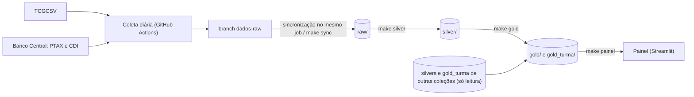

# dcs-2026-projeto

Projeto final individual da disciplina **Data Collection and Storage**: série diária de preços de uma coleção de Pokémon TCG, convertida para reais e comparada com dólar, CDI e outras coleções da turma.

## Coleção escolhida

Pokémon TCG **SV10: Destined Rivals**, sigla **DRI**, groupId **24269**.

## Visão geral

Todo dia, um workflow do GitHub Actions coleta produtos e preços da DRI no TCGCSV e uma janela de 10 dias da PTAX (câmbio USD/BRL) e do CDI no Banco Central. Ele grava as respostas originais na branch `dados-raw` e as sincroniza com o data lake da turma (bucket `tcg`). A partir do data lake, `make silver` e `make gold` constroem as camadas derivadas, e `make painel` abre o painel.



| Camada | O que guarda | Caminho no bucket `tcg` |
|---|---|---|
| raw | As quatro respostas do dia (`products.json`, `prices.json`, `cotacao.json`, `cdi.json`), byte a byte, nunca sobrescritas nem apagadas | `raw/<fonte>/group_id=24269/data=AAAA-MM-DD/` |
| silver | Tabelas no contrato comum da turma (coleção, produto, preço diário, câmbio, CDI), validadas por modelo; linhas inválidas vão para a quarentena com o motivo | `silver/<tabela>/group_id=24269/` |
| gold | Esquema estrela (fatos de preço e de câmbio, dimensões), métricas das perguntas e carteiras | `gold/group_id=24269/` |
| gold_turma | Resultado diário das cinco carteiras no contrato da turma | `gold_turma/carteira/group_id=24269/` |

A silver e a gold podem ser reconstruídas a qualquer momento a partir do bruto. Este projeto só escreve em prefixos com `group_id=24269`; as coleções dos colegas são apenas lidas.

## Perguntas e carteiras

Perguntas respondidas no painel:

- **P1, alta e queda:** quais cartas mais subiram e mais caíram em reais entre o primeiro e o último dia, com a variação decomposta em efeito da carta, do câmbio e cruzado.
- **P2, selados × raras:** como evolui o índice base 100 da cesta fixa de selados contra o da cesta fixa de cartas Double Rare em diante.
- **P3, coleções:** como evolui o valor da DRI em índice base 100 contra as outras coleções disponíveis e a PTAX.
- **P4, concentração:** no último dia, quanto do valor da coleção cada raridade concentra e quantos itens somam 80% do valor.
- **P5, risco:** retorno no período contra a volatilidade dos retornos diários de cada carta acima de US$ 5.

Carteiras de R$ 1.000,00, montadas com os preços do primeiro dia e liquidadas todo dia (com e sem a taxa de venda de 15%):

- **selado:** compra o booster box da coleção (ADR-006 para o caso sem preço).
- **cesta_raras:** R$ 100,00 em cada um dos dez itens de carta de maior preço, sem Code Card.
- **propria:** R$ 500,00 no selado mais caro que caiba e R$ 100,00 em cada uma das cinco Illustration Rare mais caras (ADR-005).
- **dolar:** compra dólar pela PTAX de venda e vende pela PTAX de compra.
- **cdi:** R$ 1.000,00 rendendo o CDI diário.

O painel também traz o placar da turma, que compara as carteiras de todas as coleções que gravaram `gold_turma/carteira/`.

## Serviços usados e custo zero

Nenhum serviço pago é usado (RNF-09):

| Serviço | Uso no projeto | Custo |
|---|---|---|
| GitHub (repositório e GitHub Actions) | Código, branch `dados-raw` com o bruto, coleta agendada e sincronização | gratuito (dentro da cota gratuita do Actions) |
| GitHub Codespaces | Ambiente de desenvolvimento e execução de `make` | gratuito (dentro da cota gratuita mensal) |
| TCGCSV (`tcgcsv.com`) | Produtos e preços da DRI | gratuito (API pública) |
| Banco Central do Brasil (PTAX e SGS/CDI) | Câmbio USD/BRL e CDI | gratuito (API pública) |
| Data lake da turma (RustFS) | Armazenamento oficial de raw, silver, gold e gold_turma | gratuito (fornecido para a turma) |
| Docker e MinIO local | Desenvolvimento e testes de integração | gratuito (código aberto) |
| Python 3.13 e bibliotecas (DuckDB, Streamlit, pydantic, minio, requests, pytest) | Pipeline, painel e testes | gratuito (código aberto) |

## Coleta agendada

O workflow `.github/workflows/coleta.yml` roda na branch `main` em dois horários, mais o disparo manual (`workflow_dispatch`):

| Execução | cron (UTC) | Papel |
|---|---|---|
| Principal | `30 20 * * *` | 20h30 UTC, 30 min depois da atualização diária do TCGCSV |
| Reserva | `30 6 * * *` | 06h30 UTC, cobre atraso ou descarte da principal |

**Data de referência (ADR-007).** O TCGCSV atualiza o preço por volta das 20h UTC. O ciclo da data D vai de 20h00 UTC de D (inclusive) a 20h00 UTC de D+1 (exclusive), e toda coleta feita nesse intervalo grava `data=D`. Exemplos: 2026-11-04T20:30Z e 2026-11-05T19:59Z gravam `data=2026-11-04`; 2026-11-05T20:00Z grava `data=2026-11-05`. Por isso, o commit na `dados-raw` pode ter carimbo de D+1 com `data=D`.

Antes de qualquer requisição, a coleta confere quais dos quatro arquivos da data de referência já existem e pula esses. A segunda execução do ciclo termina sem nenhuma requisição. Cada coleta com arquivo novo vira um commit `dados(coleta): AAAA-MM-DD [RF-01]` na `dados-raw`, e no mesmo job a branch é sincronizada com o data lake da turma, sem sobrescrever nenhuma chave.

## Riscos do agendador

- **R-01, atraso ou descarte de execuções agendadas.** O GitHub Actions pode atrasar várias horas ou descartar execuções em horário de carga. Mitigação: a regra do ciclo e a reserva das 06h30 UTC (ADR-007). Se principal e reserva falharem, dispare o workflow manualmente (Actions → coleta → Run workflow) **dentro do ciclo, antes das 20h UTC de D+1**, de preferência a partir das 20h30 UTC de D. A execução manual só busca os arquivos que faltam. Se o ciclo terminar sem os quatro arquivos, registre a data em "Dias sem coleta". Um dia perdido não se recupera, porque o TCGCSV só devolve o preço vigente.
- **R-02, prazo dos workflows agendados.** Workflows agendados só rodam a partir da branch padrão e são desativados depois de 60 dias sem atividade no repositório. Os 60 dias contam desde a última atividade no repositório, e não desde o início do projeto. O arquivo do workflow fica na `main`, e o prazo do projeto (12/12/2026) é menor que esses 60 dias. Confira na aba Actions (e com `gh run list --workflow coleta.yml`) se o agendamento do workflow `coleta` continua ativo; se ele for desativado, reative-o ali mesmo, em Actions → coleta → Enable workflow.

## Data lake

O armazenamento oficial de bruto, silver, gold e gold_turma é o bucket `tcg` do data lake da turma, um RustFS compatível com S3 (ADR-008):

- endereço: `https://lake-aulas-mackenzie.afonsolelis.tech` (região `us-east-1`, endereçamento por caminho, TLS);
- escrita só nos prefixos com `group_id=24269`; as coleções dos colegas são só lidas;
- a branch `dados-raw` continua como fonte de verdade do bruto. O workflow da coleta sincroniza a branch com o data lake todo dia, depois do push. `make sync` faz o mesmo sob demanda e nunca sobrescreve uma chave existente.

| Ambiente | Servidor S3 | Para quê |
|---|---|---|
| Oficial | Data lake da turma (RustFS), `lake-aulas-mackenzie.afonsolelis.tech`, bucket `tcg` | `make sync`, `make silver`, `make gold`, `make painel` e o passo de sincronização do workflow |
| Desenvolvimento | MinIO local (`make up`), `localhost:9000`, bucket `tcg` | Os mesmos comandos, sem tocar no data lake da turma |
| Testes de integração | MinIO descartável, criado e destruído pelo próprio teste | `make test` |

**Credenciais.** A chave de acesso é compartilhada pela turma e chega pelo canal da turma. Ela fica só em dois lugares:

- no `.env` do Codespace, copiado do `.env.example` e fora do Git: `MINIO_ACCESS_KEY` e `MINIO_SECRET_KEY`;
- nos secrets do repositório no GitHub (Settings → Secrets and variables → Actions): `MINIO_ENDPOINT`, `MINIO_ACCESS_KEY` e `MINIO_SECRET_KEY`, usados só pelo passo de sincronização do workflow.

Nunca coloque a chave em arquivo versionado, log, evidência ou mensagem de commit. Se ela vazar, avise o responsável pelo data lake para trocá-la e atualize o `.env` e os secrets.

**Desenvolvimento no MinIO local.** Para testar sem tocar no data lake da turma, suba o MinIO local com `make up` e aponte o `.env` para ele:

```dotenv
MINIO_ENDPOINT=localhost:9000
MINIO_SECURE=false
MINIO_ACCESS_KEY=<usuário raiz escolhido para o MinIO local>
MINIO_SECRET_KEY=<senha raiz escolhida para o MinIO local>
```

Volte o `.env` para `lake-aulas-mackenzie.afonsolelis.tech` e `MINIO_SECURE=true` antes de rodar `make sync`, `make silver` ou `make gold` para valer.

## Como rodar

Roteiro a partir de um clone limpo.

### 1. Pré-requisitos

- GitHub Codespaces deste repositório (recomendado) ou uma máquina Linux com o mesmo ferramental;
- Python 3.13 (já vem no Codespace);
- Docker com o plugin `docker compose` (já vem no Codespace), usado pelo MinIO local e pelos testes de integração;
- `git` com acesso ao remoto `origin`: `make sync` e `make cobertura` buscam a branch `dados-raw` por `git fetch`;
- a chave do data lake da turma, recebida pelo canal da turma.

### 2. Instalar

```bash
make setup
```

Cria o ambiente virtual `.venv` com Python 3.13, instala o pacote com as dependências de desenvolvimento (versões fixadas no `pyproject.toml`) e baixa a extensão httpfs do DuckDB.

### 3. Criar o `.env`

```bash
cp .env.example .env
```

Abra o `.env` no editor e preencha `MINIO_ACCESS_KEY` e `MINIO_SECRET_KEY` com a chave da turma. Não use `cat`, `echo` nem `printenv` para conferir os valores: o `.env` está no `.gitignore` e não deve aparecer em terminal, log nem commit. As demais variáveis já vêm com os valores do data lake da turma:

| Variável | Significado |
|---|---|
| `MINIO_ENDPOINT` | Servidor S3: `lake-aulas-mackenzie.afonsolelis.tech` (oficial) ou `localhost:9000` (MinIO local) |
| `MINIO_ACCESS_KEY`, `MINIO_SECRET_KEY` | Chave de acesso do servidor escolhido; só no `.env` |
| `MINIO_BUCKET` | `tcg` |
| `MINIO_SECURE` | `true` no data lake da turma, `false` no MinIO local |
| `GROUP_ID` | `24269`; tem de bater com `config/colecao.toml` |
| `TCG_USER_AGENT` | User-Agent próprio enviado ao TCGCSV |

Opcional, para desenvolvimento: `make up` sobe o MinIO local e espera o healthcheck; depois, aponte o `.env` para ele como na seção "Data lake".

### 4. Executar o pipeline, nesta ordem

```bash
make sync       # branch dados-raw → raw/ do data lake, sem sobrescrever chave existente
make silver     # raw/ da DRI → silver/ e quarentena
make gold       # silvers (DRI e outras coleções, só leitura) → gold/ e gold_turma/
make painel     # abre o painel Streamlit (somente leitura da gold)
make test       # testes de unidade (sem rede) e de integração (MinIO descartável, precisa de Docker)
make cobertura  # confere cada data do período contra a dados-raw e a tabela "Dias sem coleta"
```

`make cobertura` não usa o `.env` e não acessa o data lake: ele lê a branch `dados-raw` pelo Git e a tabela abaixo. Ele imprime uma linha por data (`bruto`, `registro` ou `faltante`) e termina com:

- código 0, quando cada data tem os quatro arquivos ou uma linha com motivo;
- código 1, quando há datas faltantes, listadas no fim da saída;
- código 2, em falha do Git ou entrada inválida.

`make reprocessar` apaga e reconstrói só a silver, a gold e a gold_turma do `group_id=24269`, a partir do bruto. É executado somente pelo autor e exige `CONFIRMAR=24269`.

## Documentação e evidências

- Especificação, plano e tarefas: [`specs/spec.md`](specs/spec.md), [`specs/plan.md`](specs/plan.md), [`specs/tasks.md`](specs/tasks.md).
- Persona e objetivos: [`docs/00_persona.md`](docs/00_persona.md), [`docs/01_objetivos_negocio.md`](docs/01_objetivos_negocio.md).
- Decisões de arquitetura, em [`docs/adr/`](docs/adr/):
  - [ADR-001](docs/adr/ADR-001-bruto-dados-raw.md): bruto versionado na branch `dados-raw`;
  - [ADR-002](docs/adr/ADR-002-imagem-minio.md): imagem do MinIO com tag fixada;
  - [ADR-003](docs/adr/ADR-003-estrela-outras-colecoes.md): esquema estrela na gold e leitura de outras coleções;
  - [ADR-004](docs/adr/ADR-004-camadas-derivadas.md): camadas derivadas e reprocessamento;
  - [ADR-005](docs/adr/ADR-005-carteira-propria.md): regra da carteira propria;
  - [ADR-006](docs/adr/ADR-006-fallback-selado.md): fallback do selado;
  - [ADR-007](docs/adr/ADR-007-data-referencia-ciclo-tcgcsv.md): data de referência pelo ciclo do TCGCSV e agendamento redundante;
  - [ADR-008](docs/adr/ADR-008-data-lake-rustfs.md): data lake da turma no RustFS.
- Evidências de cada tarefa (saída real dos comandos de verificação): [`docs/evidencias/`](docs/evidencias/).
- Registro dos prompts usados com agentes de IA e da revisão de cada um: [`docs/prompts.md`](docs/prompts.md).

## Dias sem coleta

Quando um ciclo terminar sem os quatro arquivos do bruto, acrescente uma linha com a data de referência (`AAAA-MM-DD`) e o motivo. Uma linha sem motivo não conta. Nada é inventado nem copiado para preencher a lacuna. `make cobertura` lê esta tabela.

| data | motivo |
|------|--------|

Observação: em 16/11/2026, `make cobertura` conferiu 13 datas, de 2026-11-03 a 2026-11-15, todas com bruto e 0 faltantes. A data 2026-11-04 não ficou sem coleta: as execuções agendadas atrasaram, e ela foi recuperada por uma execução manual dentro do ciclo, em 2026-11-05T01:31Z (`docs/evidencias/T-57_recuperacao.txt`).
