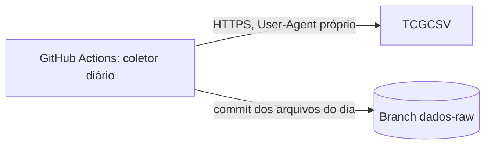

# Registro de prompts

Histórico dos prompts usados com agentes de IA em cada etapa do projeto e do resultado da revisão humana.

| data | etapa | prompt | resultado da revisão |
|------|-------|--------|----------------------|
| 2026-11-02 | 0 – Esqueleto | texto completo em [Prompt da etapa 0 – Esqueleto](#prompt-da-etapa-0--esqueleto) | aprovado sem alterações |
| 2026-11-02 | 1 – Persona | texto completo em [Prompt da etapa 1 – Persona](#prompt-da-etapa-1--persona) | aprovado com ajustes (nome da persona, pergunta 3 sem turma, coleção = DRI inteira, lacunas revisadas, escopo de leitura de outras coleções) |
| 2026-11-02 | 2 – Objetivos | texto completo em [Prompt da etapa 2 – Objetivos](#prompt-da-etapa-2--objetivos) | aprovado com ajustes (OBJ-02 com decomposição em três efeitos, OBJ-05 com cinco carteiras e fórmula de liquidação, P4 das outras coleções no OBJ-04, coleções recentes = lançadas a partir de 2024, câmbio da carteira dolar como limite declarado, encaminhamento das perguntas abertas) |
| 2026-11-02 | 3 – Especificação | texto completo em [Prompt da etapa 3 – Especificação](#prompt-da-etapa-3--especificação) | aprovado com ajustes (PTAX descartada por regra, carteiras com e sem taxa, placar da turma, execução agendada) |
| 2026-11-02 | 4 – Plano | texto completo em [Prompt da etapa 4 – Plano](#prompt-da-etapa-4--plano) | aprovado com ajustes (exclusão restrita à guarda de prefixo no RNF-03 e exceção do make reprocessar no AGENTS.md, reprocessamento inclui gold_turma, gold lê produto e colecao de todas as coleções, fontes coletadas de forma independente, bloqueio de rede por fixture, carteiras em Python puro, cobertura pela branch dados-raw, criação da branch dados-raw pelo autor, mensagem do commit automático, TCG_USER_AGENT em vars, exceção da convenção de commits para o coletor no AGENTS.md) |
| 2026-11-03 | 5 – Tarefas | texto completo em [Prompt da etapa 5 – Tarefas](#prompt-da-etapa-5--tarefas) | aprovado com ajustes (ADRs antes do código que orientam, prompts 11.1 e 11.2 no Bloco F, autoauditoria e pendências) |
| 2026-11-03 | T-01 | "prompt de implementação padrão" (texto completo em [Prompt de implementação padrão (etapa 6)](#prompt-de-implementação-padrão-etapa-6)) | plano aprovado com ajustes (Python 3.13 em vez de 3.12, já instalado no Codespace; rede só para o PyPI; alvo `make setup` que acha o python3.13 no PATH ou em `/usr/local/python/3.13.8/bin`); `make setup` e `make test`: 3 passed; evidência em `docs/evidencias/T-01_pacote.txt` |
| 2026-11-03 | T-02 | "prompt de implementação padrão" | plano aprovado com ajuste (bloqueio também de `socket.getaddrinfo`, com o teste `test_resolucao_dns_falha`); `pytest tests/unidade/test_bloqueio_rede.py`: 4 passed; `make test`: 7 passed; evidência em `docs/evidencias/T-02_bloqueio_rede.txt` |
| 2026-11-03 | T-03 | "prompt de implementação padrão" | plano aprovado com ajuste (comentários de origem em `config/parametros.toml`: "hipótese: validação pendente" com RF-01, RF-03 e RF-24; RES-03, OBJ-03 e OBJ-04 nos demais); `pytest tests/unidade/test_config.py tests/unidade/test_log.py`: 18 passed; `make test`: 25 passed; evidência em `docs/evidencias/T-03_config_log.txt` |
| 2026-11-03 | T-04 | "prompt de implementação padrão" | plano aprovado com a leitura (A) de RF-03: `tentativas` = repetições após a primeira chamada (no máximo 4 requisições, esperas de 2, 4 e 8 s); RF-03 da spec e comentário de `config/parametros.toml` ajustados; teste de falha total confere 4 requisições; depois, `specs/plan.md` (seção 5, Cliente HTTP) e a mensagem de erro de `esperas_s` em `src/tcg/config.py` ajustados ao mesmo texto; `pytest tests/unidade/test_http.py`: 8 passed; `make test`: 33 passed; evidência em `docs/evidencias/T-04_cliente_http.txt` |
| 2026-11-03 | T-05 | "prompt de implementação padrão" | plano aprovado com a janela D−9 até D (10 dias corridos, extremos incluídos); `src/tcg/coleta/tcgcsv.py` e `src/tcg/coleta/bcb.py` com URL montada como texto; consulta real ao BCB (2 requisições, status 200; TCGCSV não chamado) confirmou Olinda `CotacaoMoedaPeriodo` e SGS série 12; `pytest tests/unidade/test_clientes.py`: 10 passed; `make test`: 43 passed; evidências em `docs/evidencias/T-05_clientes.txt` e `docs/evidencias/T-05_endpoints_bcb.md` |
| 2026-11-03 | T-06 | "prompt de implementação padrão" | plano aprovado com os códigos de saída 0 (tudo gravado ou já existente), 1 (falha de alguma fonte, demais gravadas) e 2 (recusa por horário ou destino inexistente); `guarda.py`, `gravador.py` (modo `xb`) e `__main__.py`; `products.json` e `prices.json` verificados um a um; a pedido do autor, a descrição do T-10 em `specs/tasks.md` passou a exigir commit e push dos arquivos gravados também com código 1, marcando o job como falho depois, e nada a commitar com código 2; `pytest tests/unidade/test_coletor.py`: 12 passed; `make test`: 55 passed; evidência em `docs/evidencias/T-06_coletor.txt` |
| 2026-11-03 | T-07 | texto completo em [Prompt da T-07 – ADR-001](#prompt-da-t-07--adr-001) | rascunho aprovado sem alterações de conteúdo; nome do arquivo seguiu o `specs/tasks.md` (`docs/adr/ADR-001-bruto-dados-raw.md`) em vez do nome do prompt (`ADR-001-bruto-branch-dados-raw.md`); ADR salvo, T-07 marcada como [x] |
| 2026-11-03 | T-08 | "prompt de implementação padrão" | plano aprovado; commits só nos repositórios temporários dos testes, autorizados pelo autor; mensagem do commit inicial `chore(T-08): branch órfã dados-raw [RF-02]`; script cria a branch órfã por `hash-object`, `mktree`, `commit-tree` e `branch`, sem checkout, sem rede e sem push, e recusa se `dados-raw` ou `origin/dados-raw` já existir; `pytest tests/unidade/test_criar_branch.py`: 7 passed; suíte completa (`pytest -q`): 62 passed; evidência em `docs/evidencias/T-08_criar_branch.txt` |
| 2026-11-03 | T-09 | executor: autor (tarefa manual, sem prompt) | o autor rodou `scripts/criar_branch_dados_raw.sh` e publicou a branch com `git push -u origin dados-raw`; `git ls-tree origin/dados-raw` lista só `.gitattributes` e `README.md`; evidência em `docs/evidencias/T-09_branch_publicada.txt` |
| 2026-11-03 | T-10 | "prompt de implementação padrão" | plano aprovado com as tags `actions/checkout@v4` e `actions/setup-python@v5` (sem SHA, tarefa sem rede) e `pyyaml==6.0.3` nas dependências de dev do `pyproject.toml`; ajuste do autor: o teste trata a chave `on:` lida como `True` pelo `yaml.safe_load`; checkout da `main` com `persist-credentials: false`, concorrência sem cancelamento, data do commit tirada dos caminhos `data=AAAA-MM-DD`, publicação com código 0 ou 1 e job marcado como falho depois; `pytest tests/unidade/test_workflow.py`: 11 passed; suíte completa (`pytest -q`): 73 passed; evidência em `docs/evidencias/T-10_workflow.txt` |

## Prompt da etapa 0 – Esqueleto

```text
[C] Personagem
Você é um engenheiro de dados que prepara repositórios para Spec-Driven Development. Nesta etapa você só cria a estrutura de pastas e os arquivos de regras e configuração. Você não escreve código de coleta, não escolhe bibliotecas e não executa comandos que acessem a rede ou o MinIO.

[R] Pedido
Crie o esqueleto do projeto final da disciplina Data Collection and Storage na raiz deste repositório. O projeto é individual: um pipeline diário que coleta produtos e preços da coleção Pokémon TCG "SV10: Destined Rivals" (sigla DRI, groupId 24269) pelo TCGCSV, a PTAX e o CDI do Banco Central, grava a resposta original num MinIO local rodando no GitHub Codespaces (localhost:9000, bucket tcg), constrói silver e gold e alimenta um dashboard em Python.
Crie:
1. Pastas: docs/adr/, docs/evidencias/, specs/, src/, tests/unidade/, tests/integracao/, dashboard/ (com .gitkeep nas vazias).
2. README.md com: título, coleção escolhida (DRI, groupId 24269), resumo de uma linha do projeto, seção "Como rodar" com o texto "a definir nas próximas etapas" e seção "Dias sem coleta" com uma tabela vazia (data | motivo).
3. .gitignore cobrindo pelo menos: .env, .venv/, __pycache__/, *.pyc, .pytest_cache/, backup_raw/, dados_locais/.
4. .env.example só com nomes de variáveis e valores vazios ou fictícios: MINIO_ENDPOINT=localhost:9000, MINIO_ACCESS_KEY, MINIO_SECRET_KEY, MINIO_BUCKET=tcg, MINIO_SECURE=false, GROUP_ID=24269, TCG_USER_AGENT=colecao-dri/1.0.
5. AGENTS.md com as seções: Escopo; Ambiente; Arquitetura prevista; Regras de escrita no data lake; Comandos permitidos e proibidos; Política de segredos; Ordem SDD e gates por etapa; Convenção de commits.
6. CLAUDE.md contendo apenas a linha @AGENTS.md.
7. docs/prompts.md com um cabeçalho e uma tabela vazia (data | etapa | prompt | resultado da revisão).

[E] Exemplos
Trecho bem escrito do AGENTS.md:
## Regras de escrita no data lake
- Escreva somente em prefixos com group_id=24269 (tcg/raw/*/group_id=24269/, tcg/silver/*/group_id=24269/, tcg/gold/group_id=24269/, tcg/gold_turma/carteira/group_id=24269/).
- Nenhum objeto em tcg/raw/ é sobrescrito ou apagado; antes de gravar, confira se a chave já existe.

Trecho mal escrito (não faça assim):
## Regras
- Tome cuidado com os dados.

[A] Ajustes
- A credencial do MinIO local fica só no .env. O AGENTS.md deve proibir: ler ou imprimir o .env; escrever qualquer credencial em arquivo, log, evidência ou mensagem de commit; comandos de exclusão no MinIO (mc rm, mc rb, remove_object, remove_bucket ou equivalentes); git push --force.
- Na seção "Ambiente", registre: desenvolvimento e execução local no GitHub Codespaces, com Docker e Python; MinIO local por docker compose (a criar numa tarefa futura).
- Na seção "Arquitetura prevista", descreva em até cinco linhas, marcando como "a confirmar no plan.md": coleta diária no GitHub Actions, depois das 20h UTC, gravando as respostas originais numa branch dados-raw do repositório; um comando local sincroniza esses arquivos para o MinIO local, recusando sobrescrita; silver, gold e dashboard rodam a partir do MinIO local.
- Ordem SDD obrigatória no AGENTS.md: AGENTS.md → docs/00_persona.md → docs/01_objetivos_negocio.md → specs/spec.md → specs/plan.md → specs/tasks.md → implementação (uma tarefa por vez, com teste) → validação ATAM. Nenhum código em src/ antes de specs/tasks.md existir.
- Gate de cada etapa: o artefato foi revisado por mim e commitado antes da etapa seguinte.
- Convenção de commits: tipo(T-xx): descrição [RF-yy]; nesta etapa use chore(T-00): esqueleto SDD do projeto final.
- Idioma de todos os arquivos: português do Brasil.
- Não crie docs/00_persona.md, specs/spec.md nem nenhum outro artefato além dos listados.
- Não execute git commit nem git push; apenas proponha a mensagem.

[T] Tipo de saída
Os arquivos e pastas listados, em Markdown onde couber. Antes de criar, mostre a árvore de pastas e o sumário do AGENTS.md e espere minha confirmação. Ao final, mostre a saída de git status --short.

[E] Extras
Leia antes o que já existe na raiz do repositório (provavelmente só README.md) e preserve o que fizer sentido.
Fonte de dados: TCGCSV (https://tcgcsv.com/tcgplayer/3/24269/products e /prices), pede User-Agent próprio, pausa mínima de 100 ms entre chamadas e no máximo uma coleta por dia, depois das 20h UTC.
Se faltar informação, pergunte. Pare ao final.
```

## Prompt da etapa 1 – Persona

```text
[C] Personagem
Você é um analista de requisitos de engenharia de dados. Nesta etapa você só descreve pessoas e problemas. Você não propõe tecnologia, não escreve código e não executa comandos além de ler arquivos.

[R] Pedido
Preencha docs/00_persona.md com a persona principal do projeto: um colecionador de cartas Pokémon que mora no Brasil, compra cartas avulsas e produtos selados (booster box, elite trainer box, booster bundle) da coleção Destined Rivals para guardar, e quer saber onde o dinheiro dele rende mais.
Use esta estrutura:
1. Tabela da persona com as linhas: Nome e papel; Contexto; Decisão que toma; Frequência de consulta; Como decide hoje; Dor atual; O que precisa ver para decidir; Como mede sucesso.
2. Seção "Perguntas que a persona quer responder", com as cinco perguntas listadas em Extras, na linguagem dela.
3. Tabela "Fatos, lacunas e suposições" (tipo | conteúdo | origem), com pelo menos três fatos, duas lacunas e duas suposições.

[E] Exemplos
Linha bem escrita:
| Dor atual | Compra em dólar e mede o patrimônio em reais, mas não consegue separar quanto da valorização veio da carta e quanto veio da alta do dólar; também não tem histórico de preço próprio, só o preço do dia. |
Linha mal escrita (não faça assim):
| Dor atual | Precisa de um dashboard moderno com dados em tempo real. |

[A] Ajustes
- Use somente as informações deste prompt, do AGENTS.md e dos fatos listados em Extras.
- Não invente números (orçamento, quantidade de cartas, retorno esperado, tempo). Valor ausente = "hipótese: validação pendente".
- Não cite tecnologia (MinIO, DuckDB, Streamlit, GitHub Actions, Parquet) nas linhas de dor, necessidade e sucesso; a persona fala do problema dela.
- Cada fato na tabela de fatos tem origem.
- Não crie nem altere outros arquivos.

[T] Tipo de saída
Somente docs/00_persona.md, em Markdown, com no máximo uma página e meia. Antes de editar, mostre em tópicos o que vai escrever e espere minha confirmação.

[E] Extras
Leia antes: AGENTS.md.
Fatos do contexto (origem: contexto do projeto):
- o colecionador compra no marketplace TCGplayer, em dólar, e mede o patrimônio em reais;
- o preço de referência (market price) vem de vendas recentes nos Estados Unidos; não inclui frete, taxas do marketplace, IOF nem a condição da carta;
- a fonte publica o preço do dia uma vez por dia, inclusive fins de semana; o câmbio de referência (PTAX) só existe em dia útil;
- o colecionador consulta os preços uma vez por dia;
- o histórico de preço só existe a partir do primeiro dia de coleta; um dia não coletado não pode ser recuperado depois;
- para reconhecer uma carta ele precisa ver a imagem dela e poder abrir a página do produto;
- as alternativas ao colecionismo que ele compara são deixar o dinheiro em dólar ou aplicar no CDI;
- o período observado é de algumas semanas e não sustenta previsão de preço nem recomendação de compra.
As cinco perguntas:
1. Quais cartas da minha coleção mais valorizaram e quais mais desvalorizaram desde o início da coleta?
2. Na minha coleção, o produto selado guardou valor melhor que as cartas avulsas?
3. Qual coleção da turma valorizou mais no período?
4. Onde está concentrado o valor de cada coleção?
5. Quais cartas deram mais retorno para o risco assumido?
Se faltar informação para uma linha, pergunte antes de supor. Ao terminar, liste as perguntas abertas e pare.
```

### Ajustes da revisão

#### Ajuste 1 – respostas às perguntas abertas

Arquivo alterado: `docs/00_persona.md` (criado).

```text
Respostas:
1. Pode dar um nome fictício: "Rafael, colecionador de Pokémon TCG".
2. Deixe "Como decide hoje" como hipótese: validação pendente.
3. A persona não é aluno. Ela compara a Destined Rivals com outras coleções recentes do Pokémon TCG. Reescreva a pergunta 3 como "Qual coleção recente valorizou mais no período?", sem mencionar turma.
4. "Coleção" é a coleção DRI inteira (o conjunto de cartas e selados lançados), não uma lista pessoal com quantidades e preço pago. O valor da coleção é a soma de um exemplar de cada carta. Para medir quanto o dinheiro renderia, a persona pensa numa carteira hipotética de R$ 1.000 montada no primeiro dia. Ajuste o contexto e retire essa lacuna.
5. Ajustes nas lacunas e suposições:
   - "Qual câmbio usar no fim de semana" não é lacuna: no fim de semana e em feriado vale a última cotação de dia útil anterior, nunca uma posterior. Mova para fatos.
   - "Como medir risco" e "como as coleções ficam comparáveis" são decisões de especificação, não da persona. Retire daqui.
   - Mantenha as três suposições.
   - Acrescente como lacuna: "a persona aceita que o dashboard mostre evidência do período e não recomendação de compra?".
Pode escrever o arquivo.
```

#### Ajuste 2 – respostas à segunda rodada de perguntas abertas

Arquivos alterados: `docs/00_persona.md` e `docs/prompts.md` (diff do `AGENTS.md` só proposto).

```text
Respostas:
1. Mantenha a lacuna. Não reformule a pergunta 3. Corrija o AGENTS.md: coletar ou gravar dados de outras coleções continua fora do escopo; ler dados de outras coleções produzidos por terceiros, quando estiverem disponíveis, está dentro do escopo, somente leitura. Na persona, a origem desses dados fica como lacuna: dependem de outros coletores e podem não estar disponíveis.
2. Os selados ficam fora da soma. O valor da coleção é a soma de um exemplar de cada carta avulsa. Os selados entram só na pergunta 2, comparados com as cartas.
3. A divisão da carteira fica para a especificação. Na persona, basta dizer que ela compara cartas avulsas, selados, dólar e CDI.
4. Mantenha "cada coleção", porque a pergunta 4 também vale para as outras coleções quando os dados existirem.
5. Sim. Agora registre em docs/prompts.md a etapa "1 – Persona", com a data de hoje, o texto completo do prompt que eu enviei e o resultado da revisão: "aprovado com ajustes (nome da persona, pergunta 3 sem turma, coleção = DRI inteira, lacunas revisadas, escopo de leitura de outras coleções)". Não registre o Prompt 0 de novo se ele já estiver lá.

Arquivos que você pode alterar agora: docs/00_persona.md, AGENTS.md e docs/prompts.md. Mostre o diff do AGENTS.md antes de salvar.
```

#### Ajuste 3 – aprovação do diff do AGENTS.md

Arquivo alterado: `AGENTS.md`.

```text
Aprovado com a troca para "qualquer dado coletado que não venha das fontes acima". Pode salvar o AGENTS.md.
```

#### Ajuste 4 – troca para "perguntas 3, 4 e 5"

Arquivo alterado: `docs/00_persona.md`.

```text
Na lacuna sobre a origem dos dados das outras coleções, troque "(perguntas 3 e 4)" por "(perguntas 3, 4 e 5)". Não altere mais nada.
```

## Prompt da etapa 2 – Objetivos

```text
[C] Personagem
Você é um product owner técnico de uma equipe de dados. Você traduz a dor da persona em objetivos de negócio mensuráveis, drivers e restrições. Você não escreve requisitos técnicos, não escolhe bibliotecas e não escreve código.

[R] Pedido
Preencha docs/01_objetivos_negocio.md a partir de docs/00_persona.md. Escreva exatamente estes seis objetivos, cada um com descrição, métrica de sucesso verificável e origem:
OBJ-01 série diária contínua de preços da coleção DRI, sem nenhum dia inventado;
OBJ-02 valores em reais com o efeito da carta separado do efeito do câmbio;
OBJ-03 responder às perguntas 1, 2 e 4 da persona para a coleção DRI;
OBJ-04 comparar a DRI com outras coleções recentes (perguntas 3 e 5) quando os dados delas estiverem disponíveis;
OBJ-05 comparar uma carteira hipotética de R$ 1.000 em cartas avulsas e em selados com deixar o dinheiro em dólar ou no CDI;
OBJ-06 projeto reprodutível e auditável a partir de um clone limpo do repositório, sem custo e sem segredo versionado.
Liste também: drivers de negócio (DRV-xx), restrições (RES-xx, com tipo e origem) e o que fica fora do escopo.

[E] Exemplos
| OBJ-01 | Série diária contínua de preços da coleção DRI, sem nenhum dia inventado. | Toda data entre o primeiro e o último dia de coleta tem os arquivos brutos do dia ou aparece na tabela "Dias sem coleta" do README, com o motivo; zero dias preenchidos por estimativa. | Persona: "não tem histórico de preço próprio" |
| DRV-01 | Um dia sem coleta não se recupera depois, porque a fonte só devolve o preço do dia. | Contexto do projeto |
| RES-02 | Custo zero: nenhum serviço pago | financeira | Decisão do autor |

[A] Ajustes
- Cada objetivo precisa de uma métrica verificável por um comando, um teste ou uma observação concreta. Se o valor não estiver nos fatos de Extras, escreva "hipótese: validação pendente" e diga como medir.
- Para OBJ-04, a métrica deve aceitar o resultado parcial: quando os dados de outras coleções não existirem, o painel informa a ausência em vez de mostrar dado vazio ou inventado.
- Restrições têm tipo (técnica, financeira, legal, prazo) e origem.
- Fora do escopo, inclua pelo menos: previsão de preço e recomendação de compra; coleta ou gravação de outras coleções; streaming em tempo real; preço de carta graduada (PSA, CGC); scraping de sites que bloqueiam acesso automatizado.
- Não altere docs/00_persona.md.
- Não escolha tecnologia além das que estão nas restrições.

[T] Tipo de saída
Somente docs/01_objetivos_negocio.md, em Markdown, com tabelas para objetivos, drivers, restrições e fora do escopo. Mostre o plano antes de editar e espere minha confirmação.

[E] Extras
Leia antes: AGENTS.md e docs/00_persona.md.
Fatos e restrições (origem: contexto do projeto, salvo indicação):
- Fonte de preços: TCGCSV, sem chave; pede User-Agent próprio, pausa mínima de 100 ms entre chamadas e no máximo 10.000 requisições por dia; atualiza por volta das 20h UTC; o preço muda uma vez por dia.
- Câmbio: PTAX de fechamento do Banco Central, só em dia útil; no fim de semana e em feriado vale a última PTAX de dia útil anterior, nunca uma posterior.
- CDI: série diária do Banco Central, só em dia útil.
- Filtros de relevância: na pergunta 1, só cartas acima de US$ 1 no primeiro dia; na pergunta 5, só cartas acima de US$ 5; cartas de código digital (raridade Code Card) ficam fora das perguntas 1, 3 e 4.
- Carteira: valor de liquidação diário, unidades inteiras, taxa de venda como parâmetro com 15% como hipótese declarada.
- Repositório público no GitHub; credenciais só no .env e em secrets.
- Execução: GitHub Codespaces com MinIO local; coleta diária agendada no GitHub Actions (decisão do autor; detalhes no plan.md).
- Custo zero (decisão do autor).
- Prazo de entrega: 12/12/2026, 23h59.
- O período observado é de algumas semanas e não sustenta previsão.
Se faltar informação, pergunte. Ao terminar, liste perguntas abertas e pare.
```

### Ajustes da revisão

#### Ajuste 1 – aprovação do plano com ajustes

Arquivo alterado: `docs/01_objetivos_negocio.md` (criado).

```text
Plano aprovado com estes ajustes:

OBJ-02: a variação em reais se decompõe em três partes, não duas: efeito da carta, efeito do câmbio e efeito cruzado, pela identidade (1 + r_brl) = (1 + r_usd) × (1 + r_cambio). A métrica deve dizer que um teste confere essa identidade, com tolerância de arredondamento.

OBJ-05: são cinco carteiras, todas partindo de R$ 1.000 no primeiro dia de coleta:
- selado: unidades inteiras do booster box da coleção; se ele não tiver preço no primeiro dia, o selado de maior preço que tiver preço (escolha registrada em ADR);
- cesta_raras: R$ 100 em cada uma das dez cartas de maior market price no primeiro dia, em unidades inteiras;
- propria: regra definida pelo autor, registrada em ADR antes do primeiro cálculo;
- dolar: R$ 1.000 convertidos pela PTAX de venda do primeiro dia e guardados em dólar;
- cdi: R$ 1.000 corrigidos pelo CDI de cada dia útil, com juros compostos.
A métrica deve incluir: valor de liquidação diário = unidades × market price × (1 − taxa de venda) × PTAX de compra, mais a sobra em caixa, que rende CDI; a composição usa só dados do primeiro dia, e um teste confirma que acrescentar dias posteriores não muda a composição.

Respostas às perguntas abertas:
1. Respondida acima.
2. Sim: dólar comprado pela PTAX de venda e vendido pela PTAX de compra, sem spread nem IOF. Registre como limite declarado.
3. Sim, inclua a P4 das outras coleções no OBJ-04.
4. Coleções recentes = coleções principais do Pokémon TCG lançadas a partir de 2024.

Pode escrever o arquivo.
```

#### Ajuste 2 – encaminhamento das perguntas abertas e registro da etapa

Arquivos alterados: `docs/01_objetivos_negocio.md` e `docs/prompts.md`.

```text
RES-03 pode ficar como "legal".

Na seção de perguntas abertas, registre o encaminhamento de cada uma:
1. cesta_raras: sim, excluem Code Card e selados (só cartas avulsas). O critério de desempate fica para o spec.md.
2. Sim: se o primeiro dia cair em fim de semana ou feriado, vale a PTAX de dia útil anterior, pela mesma regra do OBJ-02.
3. Fica para o plan.md.
4. Fica como hipótese até a primeira coleta.
5. Continua pendente, a validar na primeira coleta.

Depois registre em docs/prompts.md a etapa "2 – Objetivos", com o prompt original e, na subseção "Ajustes da revisão", as minhas mensagens de ajuste desta etapa (a de aprovação do plano e esta), anotando qual arquivo cada uma mudou. Não altere outros arquivos.
```

## Prompt da etapa 3 – Especificação

```text
[C] Personagem
Você é um engenheiro de requisitos de dados. Você escreve requisitos funcionais e não funcionais com critérios de aceite verificáveis. Você não escreve código e só cita tecnologia quando ela já é restrição em docs/01_objetivos_negocio.md ou contrato listado em Extras.

[R] Pedido
Escreva specs/spec.md derivando os requisitos de docs/00_persona.md e docs/01_objetivos_negocio.md. Cubra no mínimo:
1. Coleta diária de produtos e preços da coleção (TCGCSV), da PTAX e do CDI, uma vez por dia depois das 20h UTC, com User-Agent próprio, pausa entre chamadas e repetição com espera crescente.
2. Gravação da resposta original sem alteração, com chave por coleção e data, recusando sobrescrita (inclusive na sincronização para o MinIO local).
3. Silver nas cinco tabelas do contrato comum (Extras), com validação por modelo por tabela, quarentena com motivo e preço ausente gravado como nulo.
4. Gold em esquema estrela sobre a silver de todas as coleções disponíveis.
5. Conversão para reais pela última PTAX de fechamento conhecida no dia do preço, nunca posterior, guardando a cotação aplicada e a data do boletim.
6. Reprocessamento: silver e gold reconstruídas a partir do bruto com um único comando, sem duplicar linhas.
7. Dashboard com as cinco perguntas (métricas em Extras), valores em reais com opção de ver em dólar, filtros de preço mínimo em dólar, imagem das cartas citadas, link da página do produto, decomposição carta/câmbio/cruzado, lacunas visíveis sem interpolação e aviso de que o período não sustenta previsão.
8. Desafio das cinco carteiras (regras em docs/01_objetivos_negocio.md), com as métricas de Extras e resultado no contrato gold_turma.
9. Leitura somente leitura de outras coleções quando disponíveis, com aviso explícito quando ausentes.
10. Dias sem coleta declarados no README.
11. Testes: unidade sem rede; integração com respostas HTTP gravadas para o TCGCSV; integração com MinIO em contêiner descartável.
12. Segredos fora do Git, custo zero e reprodução a partir de clone limpo.

[E] Exemplos
### RF-02: grava a resposta do dia no bruto sem sobrescrever
A resposta original do TCGCSV é gravada sem alteração na chave do dia da coleção.
- Origem: OBJ-01, RES-08
- Critério de aceite:
  - Dado que a chave tcg/raw/tcgplayer/group_id=24269/data=2026-11-02/prices.json já existe
  - Quando a gravação do mesmo dia for executada de novo
  - Então a gravação é recusada, o objeto original continua igual (mesmo hash) e a recusa aparece no log

### RNF-04: conversão nunca usa cotação posterior
- Atributo: correção dos dados
- Origem: OBJ-02, RES-04
- Critério de aceite:
  - Dado preços de 10/10/2026 (sábado), 11/10 (domingo) e 12/10 (feriado) e PTAX de 09/10 e 13/10
  - Quando a conversão for executada
  - Então os três dias usam a PTAX de 09/10 e nenhum usa a de 13/10

[A] Ajustes
- Numere RF-01, RF-02... e RNF-01, RNF-02...; cada requisito tem origem (OBJ, DRV ou RES).
- Todo critério de aceite usa Dado/Quando/Então e pode ser verificado por um comando ou teste.
- Copie os nomes e tipos de colunas do contrato exatamente como em Extras; colunas extras são permitidas, mudar nome ou tipo não.
- Não invente números. Valor ausente = "hipótese: validação pendente". Hipóteses de docs/ continuam hipóteses.
- Resolva aqui as pendências encaminhadas ao spec: desempate da cesta_raras (sugestão: menor product_id) e o grão de cada pergunta.
- Inclua uma seção "Fora do escopo" coerente com docs/01_objetivos_negocio.md.
- Não altere outros arquivos.

[T] Tipo de saída
Somente specs/spec.md, em Markdown, com no máximo quatro páginas. Antes de escrever, mostre só a lista de títulos dos RF e RNF e espere minha confirmação.

[E] Extras
Leia antes: AGENTS.md, docs/00_persona.md, docs/01_objetivos_negocio.md.

Chaves do bruto (MinIO, bucket tcg):
raw/tcgplayer/group_id=24269/data=AAAA-MM-DD/products.json
raw/tcgplayer/group_id=24269/data=AAAA-MM-DD/prices.json
raw/bcb_ptax/group_id=24269/data=AAAA-MM-DD/cotacao.json
raw/bcb_cdi/group_id=24269/data=AAAA-MM-DD/cdi.json

Contrato comum da silver (colunas mínimas):
- colecao: group_id INTEGER, nome VARCHAR, sigla VARCHAR, data_lancamento DATE, responsavel VARCHAR
- produto: product_id INTEGER, group_id INTEGER, nome VARCHAR, tipo_produto VARCHAR ('carta' ou 'selado'), raridade VARCHAR, numero VARCHAR, image_url VARCHAR, url VARCHAR
- preco_diario (grão: produto, acabamento, dia): data DATE, product_id INTEGER, group_id INTEGER, acabamento VARCHAR, market_price DOUBLE, low_price DOUBLE, mid_price DOUBLE, high_price DOUBLE, moeda VARCHAR, fonte VARCHAR, chave_raw VARCHAR
- cambio_diario (dia útil): data DATE, cotacao_compra DOUBLE, cotacao_venda DOUBLE, data_hora_cotacao TIMESTAMP, boletim VARCHAR ('Fechamento'), chave_raw VARCHAR
- cdi_diario (dia útil): data DATE, taxa_dia DOUBLE (% ao dia, como publicada), chave_raw VARCHAR
Caminhos: silver/colecao/group_id=24269/colecao.parquet; silver/produto/group_id=24269/produto.parquet; silver/preco_diario/group_id=24269/data=AAAA-MM-DD/preco.parquet; silver/cambio_diario/group_id=24269/cambio.parquet; silver/cdi_diario/group_id=24269/cdi.parquet

Gold: fato_preco_diario (produto, acabamento, dia: market, low, mid, high, market_price_brl, cotação aplicada, data_ptax), dim_produto, dim_colecao, dim_data, dim_acabamento, fato_cambio_diario (dia de calendário: PTAX aplicada, data do boletim de origem, CDI do dia, zero em dia sem taxa). Dias desde o lançamento calculados na consulta.

Contrato gold_turma: gold_turma/carteira/group_id=24269/carteira.parquet com data DATE, group_id INTEGER, carteira VARCHAR (selado, cesta_raras, propria, dolar, cdi), valor_brl DOUBLE, retorno_acumulado DOUBLE, taxa_venda DOUBLE.

Métricas das perguntas:
- P1: variação % em reais entre o primeiro e o último dia, por carta e acabamento, decomposta em carta, câmbio e cruzado; só cartas acima de US$ 1 no primeiro dia; dois rankings de dez, com imagem e preço inicial e atual em reais.
- P2: índice base 100 no primeiro dia: média dos selados contra a soma do preço das cartas de raridade Double Rare em diante; gráfico de linhas.
- P3: valor da coleção no dia em reais (soma do market_price_brl de um exemplar de cada carta) em índice base 100, por coleção, com a PTAX em índice base 100 no mesmo gráfico; destaca a DRI.
- P4: participação de cada raridade no valor total no último dia e número de cartas que somam 80% do valor; barras empilhadas a 100% por coleção.
- P5: retorno no período contra volatilidade (desvio-padrão dos retornos diários), cartas acima de US$ 5; dispersão com cor por coleção e imagem ao passar o cursor.
- Code Card fora de P1, P3 e P4.

Métricas da carteira: retorno acumulado (valor no último dia / 1000 − 1); excesso sobre o CDI; perda máxima (maior queda % entre um pico e o ponto mais baixo depois dele); dias com preço carregado. Produto sem preço no dia usa o último preço observado só na avaliação da carteira, marcado no painel, sem gravar nada na silver. CDI não rende em fim de semana nem feriado.

Se faltar informação, pergunte. Ao terminar, liste perguntas abertas e pare.
```

### Ajustes da revisão

#### Ajuste 1 – aprovação dos títulos e respostas às perguntas

Arquivo alterado: `specs/spec.md` (criado).

```text
Confirme que existe o RF-15 (P1: rankings de alta e queda com a decomposição carta, câmbio e cruzado); na sua lista ele aparece cortado junto do RF-14.

Respostas:
1. Sim: arquivo de configuração versionado, declarado pelo autor, com nome "SV10: Destined Rivals", sigla "DRI", data_lancamento 2025-05-30 e responsavel "Augusto".
2. Sim: lista ordenada no spec, marcada como hipótese até a primeira coleta. Considere "Double Rare em diante" = Double Rare, Ultra Rare, Illustration Rare, Special Illustration Rare e Hyper Rare; se a fonte trouxer outra raridade, ela entra como pendência na primeira coleta.
3. Sim, como hipótese, com uma exceção: produto com raridade "Code Card" é carta (e fica fora de P1, P3 e P4), nunca selado.
4. Sim: o grão é o par produto × acabamento em todo o projeto. Uma carta em Holofoil e a mesma em Reverse Holofoil contam como itens distintos, inclusive na cesta_raras, na P5 e no "um exemplar de cada carta" da P3 e da P4. Registre essa decisão no spec.
5. Sim: parâmetro configurável, marcado como hipótese. Valores iniciais sugeridos: 3 tentativas, com espera de 2, 4 e 8 segundos.

Mais um detalhe no RF-01: o CDI de um dia útil só é publicado na manhã seguinte, então a coleta diária consulta uma janela recente do CDI (e não só o dia) e grava a resposta inteira.

Pode escrever o arquivo.
```

#### Ajuste 2 – respostas às perguntas abertas e diff do AGENTS.md

Arquivo alterado: `specs/spec.md` (diff do `AGENTS.md` só proposto).

```text
Tamanho: mantenha o formato atual (sem converter em tabelas) e só corte as repetições das seções "Contratos" e "Definições".

Respostas:
1. A gold persistida em tcg/gold/group_id=24269/ é construída sobre a silver de todas as coleções disponíveis: a DRI e as de terceiros, lidas somente para leitura. Isso não é gravar outras coleções: a escrita continua só no nosso prefixo. Ajuste o AGENTS.md: "a silver é derivada exclusivamente da raw da DRI; a gold é derivada da silver da DRI e das silvers de outras coleções disponíveis, lidas somente para leitura". Mostre o diff do AGENTS.md antes de salvar.
2. Sim: a PTAX também é coletada numa janela recente, como o CDI, e o arquivo continua sendo cotacao.json. Se dois brutos trouxerem valores diferentes para a mesma data, a data vai para a quarentena, com a mesma regra do CDI.
3. Sim: as carteiras de cartas e selados compram pela PTAX de venda, sem taxa na compra. Registre como limite declarado.
4. Sim: taxa_venda = 0 nas carteiras dolar e cdi.
5. Sim: o primeiro dia comum a todas as coleções exibidas.
6. Sim: descartar os retornos que atravessam uma lacuna; só contam retornos entre dias consecutivos com preço.
7. Sim, como hipótese a validar na primeira coleta.
8. 10 dias corridos para o CDI e para a PTAX, como parâmetro configurável e marcado como hipótese.

O desempate por acabamento em ordem alfabética está aprovado.

Arquivos que você pode alterar agora: specs/spec.md e AGENTS.md.
```

#### Ajuste 3 – aprovação do diff do AGENTS.md

Arquivo alterado: `AGENTS.md`.

```text
Pode salvar o AGENTS.md.
```

#### Ajuste 4 – quarentena, taxa lado a lado, placar da turma e execução agendada

Arquivos alterados: `specs/spec.md` e `docs/prompts.md`.

```text
Ajustes no specs/spec.md:

1. RF-07: boletins da PTAX diferentes de "Fechamento" são descartados por regra, não vão para a quarentena; troque o exemplo do critério por uma PTAX de fechamento com cotacao_venda ausente. Acrescente que a contagem de linhas em quarentena por tabela aparece no log de cada execução.

2. RF-24 ou RF-25: o painel mostra o resultado de cada carteira com a taxa de venda e sem ela (taxa 0), lado a lado. Critério: a diferença entre as duas versões aparece no painel para as carteiras selado, cesta_raras e propria, e é zero para dolar e cdi.

3. Novo RF-28, placar da turma: o painel lê gold_turma/carteira de todas as coleções disponíveis (somente leitura) e mostra em quantas coleções o selado superou o CDI, em quantas a cesta_raras superou o dólar e qual coleção teve a menor perda máxima. Sem dados de outras coleções, mostra o aviso explícito e só a DRI. Origem: OBJ-04, OBJ-05, RES-13.

4. Novo RNF-13, execução agendada: a coleta roda todo dia depois das 20h UTC sem intervenção manual, com credenciais só em variáveis e secrets. Critério: o histórico de execuções do agendador mostra uma execução por dia no período; dias sem execução bem-sucedida aparecem na tabela "Dias sem coleta". Origem: OBJ-01, DRV-01, RES-06, RES-07.

Não altere outros arquivos. Depois registre esta mensagem em docs/prompts.md, na subseção "Ajustes da revisão" da etapa 3.
```

## Prompt da etapa 4 – Plano

````text
[C] Personagem
Você é um arquiteto de software de dados. Você transforma a spec em arquitetura e justifica cada escolha por um requisito ou restrição. Você não escreve código nesta etapa.

[R] Pedido
Escreva specs/plan.md com:
1. C4 nível 1 (contexto), nível 2 (contêineres) e nível 3 (componentes do pipeline), em blocos Mermaid.
2. Fluxo diário, passo a passo, da coleta ao painel.
3. Tabela de escolhas técnicas: escolha | alternativas consideradas | RF/RNF/RES atendido | ADR previsto.
4. Estrutura de pastas do código e comandos de execução previstos.
5. Riscos técnicos iniciais e perguntas abertas.
O plano deve conter estas decisões, já tomadas pelo autor:
- Coleta no GitHub Actions: workflow agendado diariamente às 20h30 UTC, mais disparo manual (workflow_dispatch). O job usa Python 3.12, busca TCGCSV, PTAX e CDI e grava as respostas originais como arquivos na branch dados-raw, no caminho idêntico à chave do bruto (raw/tcgplayer/group_id=24269/data=AAAA-MM-DD/products.json etc.); recusa gravar se o arquivo do dia já existir; faz commit e push só na branch dados-raw. O job não precisa de credenciais do MinIO, porque não acessa o MinIO.
- MinIO local no Codespace por docker compose, imagem ghcr.io/coollabsio/minio com tag fixada RELEASE.2025-10-15T17-29-55Z (nunca latest), portas 9000 (API) e 9001 (console), volume nomeado e healthcheck com "mc ready local"; credenciais no .env.
- Sincronização: comando local que lê os arquivos da branch dados-raw e envia ao bucket tcg com a mesma chave, conferindo antes se a chave existe (recusa sobrescrita).
- Bibliotecas Python: requests para HTTP; minio (SDK oficial) para gravar e ler objetos; pydantic v2 para os modelos da silver; duckdb com a extensão httpfs para ler e gravar Parquet no MinIO, montar a gold e fazer o ASOF JOIN; streamlit para o painel; pytest, vcrpy (respostas HTTP gravadas) e testcontainers (MinIO descartável) para os testes.
- Silver em Python + pydantic; gold em SQL no DuckDB, lendo a silver de todas as coleções com curinga (s3://tcg/silver/preco_diario/*/*/*.parquet) e gravando só em gold/group_id=24269/ e gold_turma/carteira/group_id=24269/.
- Configuração da coleção em config/colecao.toml (nome, sigla, data_lancamento, responsavel, group_id) e parâmetros (janela de 10 dias, tentativas, esperas, taxa_venda) em config/parametros.toml.
- Comandos únicos por um Makefile: make up (sobe o MinIO), make sync, make silver, make gold, make reprocessar (apaga e reconstrói só silver e gold do nosso prefixo a partir do bruto), make painel, make test, make cobertura (RF-27).
- Logs no padrão logging do Python, na saída padrão, sem nenhum valor de credencial.

[E] Exemplos


| Escolha | Alternativas | Requisito/restrição | ADR |
| Bruto versionado na branch dados-raw e sincronizado para o MinIO local | MinIO público pago no Railway; armazenamento S3 gratuito de terceiros; agendador no computador do autor | RF-01, RF-05, RNF-09, RNF-13, RES-02, RES-07 | ADR-001 |

[A] Ajustes
- Os nomes usados nos diagramas são exatamente os nomes usados no texto.
- Toda escolha técnica aponta para RF, RNF ou RES de specs/spec.md ou docs/01_objetivos_negocio.md; escolha sem origem fica marcada "sem requisito correspondente".
- Para cada decisão relevante, liste pelo menos duas alternativas descartadas e o motivo.
- Não acrescente componentes que a spec não pede (fila, orquestrador, banco relacional, ClickHouse, RabbitMQ).
- O comando de reprocessamento só apaga objetos de silver e gold do prefixo group_id=24269; isso precisa ficar explícito, porque o AGENTS.md proíbe exclusões no bruto e fora do nosso prefixo. Aponte se isso exige ajuste no AGENTS.md.
- Indique os ADRs previstos (numere a partir de ADR-001), sem escrevê-los.
- Não altere outros arquivos.

[T] Tipo de saída
Somente specs/plan.md, em Markdown com blocos ```mermaid. Mostre a lista de seções e a tabela de escolhas antes de escrever e espere minha confirmação.

[E] Extras
Leia antes: AGENTS.md, docs/00_persona.md, docs/01_objetivos_negocio.md, specs/spec.md.
Os ADRs serão escritos na etapa de validação; aqui só o número e o título previstos. Sugestão de ADRs: bruto na branch dados-raw com sincronização; imagem do MinIO com tag fixada; esquema estrela na gold; camadas derivadas e reprocessamento; regra da carteira propria; fallback do selado.
Se uma decisão acima contradisser a spec, aponte a contradição e pergunte. Pare ao final.
````

### Ajustes da revisão

#### Ajuste 1 – exclusão restrita, reprocessamento, curingas da gold e decisões não bloqueantes

Arquivo alterado: `specs/plan.md` (criado). Os diffs de `specs/spec.md` e `AGENTS.md` foram mostrados, sem salvar.

```text
Pontos:
1. Opção (a). Ajuste o RNF-03 para: "a única exclusão do código fica numa função que só aceita os prefixos silver/*/group_id=24269/, gold/group_id=24269/ e gold_turma/carteira/group_id=24269/ e recusa qualquer chave em raw/ ou de outro group_id; um teste confirma a recusa". No AGENTS.md, acrescente que make reprocessar, executado pelo autor, é a única exceção à proibição de exclusões, e que o agente continua proibido de executar qualquer exclusão. Mostre os diffs do spec e do AGENTS.md antes de salvar.
2. Sim, o reprocessamento também reconstrói gold_turma/carteira/group_id=24269/.
3. Sim, a gold também lê silver/produto/*/*.parquet e silver/colecao/*/*.parquet de todas as coleções, somente leitura. Câmbio e CDI vêm só da nossa silver.

Decisões para os itens não bloqueantes (entram no plano):
- Atraso do cron: aceito como risco; mitigação: disparo manual (workflow_dispatch) no mesmo dia, antes de 23h59 UTC. Documente no README.
- .gitattributes com "* -text" na branch dados-raw: sim.
- Dia parcial: cada fonte é verificada e gravada de forma independente. A reexecução no mesmo dia busca só as fontes cujo arquivo do dia ainda não existe (o TCGCSV continua no máximo uma vez por dia). Se uma fonte não for gravada no dia, o dia entra na tabela "Dias sem coleta" com o motivo; PTAX e CDI se recuperam pela janela de 10 dias.
- Bloqueio de rede nos testes de unidade: fixture no tests/conftest.py que substitui socket.socket e falha em qualquer conexão, sem biblioteca nova.
- Carteiras: composição e liquidação em funções Python puras, testáveis sem rede; os dados entram e saem pelo DuckDB.
- make cobertura lê a branch dados-raw, que é a fonte de verdade do bruto.
- Healthcheck: confirmar na tarefa de implementação do docker compose.

Arquivos que você pode alterar agora: specs/plan.md, specs/spec.md (só o RNF-03) e AGENTS.md (só a linha da exceção).
```

#### Ajuste 2 – aprovação dos diffs e respostas às perguntas da seção 14

Arquivos alterados: `specs/spec.md` (RNF-03), `AGENTS.md` (linha da exceção), `specs/plan.md` (seções 5, 6, 8, 9, 14 e 15) e `docs/prompts.md`.

```text
Aprovo os dois diffs; pode salvar o spec e o AGENTS.md e marcar os ajustes como aplicados na seção 15.

Respostas às perguntas da seção 14:
1. A branch dados-raw é criada uma única vez pelo autor, numa tarefa de implementação, como branch órfã contendo só o .gitattributes e um README curto; o agente prepara os comandos e o autor executa.
2. Mensagem do commit automático do coletor: "dados(coleta): AAAA-MM-DD [RF-01]".
3. TCG_USER_AGENT é variável do repositório (vars), não secret, porque não é sensível. O workflow do coletor não usa nenhum secret; ele precisa só de permissão contents: write para dar push na branch dados-raw.
Mova essas três da seção 14 para as decisões do plano.

Depois registre em docs/prompts.md a etapa "4 – Plano": o prompt original e, em "Ajustes da revisão", as minhas mensagens desta etapa, na ordem, com o arquivo que cada uma mudou, e o resultado "aprovado com ajustes". Não altere outros arquivos.
```

#### Ajuste 3 – exceção da convenção de commits para o coletor

Arquivos alterados: `AGENTS.md` (convenção de commits) e `docs/prompts.md`.

```text
Ajuste o AGENTS.md, na seção de convenção de commits, acrescentando: "Exceção: os commits automáticos do coletor, feitos só na branch dados-raw, usam o formato dados(coleta): AAAA-MM-DD [RF-01]; a convenção tipo(T-xx): descrição [RF-yy] vale para todos os commits na main." Mostre o diff e, se ficar só essa linha, pode salvar sem esperar. Depois acrescente esta mensagem em "Ajustes da revisão" da etapa 4 no docs/prompts.md.
```

## Prompt da etapa 5 – Tarefas

```text
[C] Personagem
Você é o líder técnico do projeto. Você quebra o plano em tarefas pequenas, cada uma com requisito, verificação executável e evidência esperada. Você não escreve código nesta etapa.

[R] Pedido
Escreva specs/tasks.md a partir de specs/spec.md e specs/plan.md, com uma tabela de tarefas e as colunas: ID | Tarefa | Requisitos | Verificação (comando) | Evidência esperada | Depende de | Executor | Status.
A ordem de execução segue esta prioridade, em blocos:
Bloco A, coleta no ar (prioridade máxima, porque um dia sem coleta não se recupera): estrutura do pacote Python e dependências; bloqueio de rede nos testes de unidade; arquivos de configuração e leitor; cliente HTTP com User-Agent, pausa e repetição; coletor das três fontes com guarda de horário e de duplicidade por arquivo e gravação dos arquivos do dia; criação da branch órfã dados-raw com .gitattributes; workflow do GitHub Actions com agendamento e disparo manual; primeira execução manual do workflow, conferida na branch.
Bloco B, armazenamento local: docker compose do MinIO com healthcheck; sincronizador com recusa de sobrescrita; testes de integração com MinIO descartável e com respostas HTTP gravadas.
Bloco C, lakehouse: modelos pydantic e silver com quarentena; função única de exclusão com guarda de prefixo; gold em estrela com ASOF JOIN e fato de câmbio; reprocessamento.
Bloco D, análise: decomposição carta/câmbio/cruzado; métricas das perguntas P1 a P5; composição, liquidação e métricas das carteiras; gravação em gold_turma.
Bloco E, painel e operação: painel com as cinco perguntas, carteiras e placar; verificação de cobertura; README completo.
Separe as tarefas manuais do autor (criar a branch dados-raw, criar a variável TCG_USER_AGENT no GitHub, disparar o workflow, preencher o .env) das tarefas do agente.

[E] Exemplos
| T-05 | Coletor das três fontes: verifica cada arquivo do dia antes de qualquer requisição, recusa antes das 20h UTC e grava as respostas originais em raw/... | RF-01, RF-02, RF-04 | pytest tests/unidade/test_coletor.py | testes de recusa por horário, recusa por arquivo existente e hash igual ao corpo passam | T-03, T-04 | agente | [ ] |
| T-07 | Criar a branch órfã dados-raw com .gitattributes ("* -text") e README curto | RF-02, ADR-001 | git ls-tree origin/dados-raw | a branch existe no GitHub com os dois arquivos | T-06 | autor | [ ] |

[A] Ajustes
- Cada tarefa cabe num único prompt de implementação e toca poucos arquivos, com o teste junto.
- Todo RF e RNF de specs/spec.md aparece em pelo menos uma tarefa; os que não couberem vão para uma seção "Requisitos sem tarefa", com o motivo.
- A verificação é um comando que o autor consegue executar e ver passar ou falhar.
- Marque as tarefas que exigem rede ou contêiner.
- A etapa de validação (ATAM, ADRs, matriz de rastreabilidade) entra como último bloco, com tarefas próprias.
- Todas as tarefas começam com status [ ].
- Não altere outros arquivos.

[T] Tipo de saída
Somente specs/tasks.md, em Markdown. Antes de escrever, mostre só a lista de tarefas (ID, título, requisitos e executor) e espere minha confirmação.

[E] Extras
Leia antes: AGENTS.md, specs/spec.md e specs/plan.md.
Ao final do arquivo, inclua uma seção "Cobertura" com a lista de RF e RNF e a tarefa que atende cada um.
Se faltar informação, pergunte. Pare ao final.
```

### Ajustes da revisão

#### Ajuste 1 – aprovação da lista com ajustes

Arquivo alterado: `specs/tasks.md` (criado).

```text
Lista aprovada, com as seis decisões, e estes ajustes:

1. Os ADRs saem do T-47 e vão para logo antes da primeira tarefa que orientam, cada um como tarefa própria do agente, revisada e commitada antes do código:
- ADR-001 (bruto na branch dados-raw com sincronização): antes do T-07.
- ADR-002 (imagem do MinIO com tag fixada): antes do T-13.
- ADR-003 (esquema estrela na gold e leitura de outras coleções): antes do T-26.
- ADR-004 (camadas derivadas e reprocessamento): antes do T-20.
- ADR-006 (fallback do selado): antes do T-36, depois do T-12, porque depende de saber se o booster box tem preço.
O ADR-005 continua no T-35. Renumere as tarefas.

2. Bloco F:
- A matriz de rastreabilidade usa o prompt 11.2 do enunciado da Aula 08.
- Acrescente uma tarefa final de autoauditoria com o prompt 11.1 do enunciado, gravando docs/auditoria_final.md, sem corrigir nada.
- Acrescente uma tarefa de registro de pendências em docs/pendencias_aula08.md.

Pode escrever o specs/tasks.md.
```

## Prompt de implementação padrão (etapa 6)

Usado em cada tarefa de `specs/tasks.md`, trocando apenas o identificador da tarefa (T-01 no texto abaixo).

```text
[C] Personagem
Você é um engenheiro de dados que implementa com disciplina de testes. Você executa uma única tarefa, prova que ela funciona com a saída real do terminal e para.

[R] Pedido
Implemente a tarefa T-01 de specs/tasks.md. Siga esta ordem:
1. mostre o plano: arquivos que vai criar ou alterar, o teste que vai escrever e o comando de verificação;
2. espere minha confirmação;
3. crie ou altere os arquivos, com o teste junto;
4. execute a verificação indicada na tarefa e mostre a saída real;
5. se passou: salve a saída em docs/evidencias/T-xx_<nome>.txt, marque a tarefa como [x] em specs/tasks.md, acrescente em docs/prompts.md uma linha na tabela (data | T-xx | "prompt de implementação padrão" | resultado) e proponha a mensagem de commit no formato tipo(T-xx): descrição [RF-yy].

[E] Exemplos
Evidência bem registrada (docs/evidencias/T-04_cliente_http.txt):
$ pytest tests/unidade/test_cliente_http.py -v
tests/unidade/test_cliente_http.py::test_user_agent_em_toda_requisicao PASSED
tests/unidade/test_cliente_http.py::test_pausa_minima_100ms PASSED
tests/unidade/test_cliente_http.py::test_repeticao_com_espera_crescente PASSED
3 passed in 0.41s
Mensagem de commit: feat(T-04): cliente HTTP com User-Agent, pausa e repetição [RF-03]

[A] Ajustes
- Faça somente a tarefa pedida. Não adiante outras tarefas.
- Siga o AGENTS.md, specs/spec.md e specs/plan.md; se a tarefa contradisser algum deles, pare e pergunte.
- Não leia nem imprima o .env; não escreva credenciais em código, log, evidência ou commit.
- Não execute exclusões no MinIO nem git push --force; não faça git commit nem git push.
- Se a verificação falhar, mostre o erro e tente corrigir no máximo duas vezes; depois disso, pare e explique.
- Não declare sucesso sem mostrar a saída real do comando.

[T] Tipo de saída
Os arquivos da tarefa, a evidência, specs/tasks.md e docs/prompts.md atualizados, e um resumo de até cinco linhas com o que mudou e a mensagem de commit proposta.

[E] Extras
Leia antes: AGENTS.md, specs/spec.md, specs/plan.md e specs/tasks.md.
Nesta primeira tarefa, registre também em docs/prompts.md o texto completo deste prompt numa seção "Prompt de implementação padrão (etapa 6)".
Pare ao final da tarefa.
```

## Prompt da T-07 – ADR-001

```text
[C] Personagem
Você é um arquiteto de software de dados. Você registra uma decisão já tomada pelo autor, com as alternativas descartadas e os custos dela. Você não escreve código nesta etapa.

[R] Pedido
Execute a tarefa T-07 de specs/tasks.md: escreva docs/adr/ADR-001-bruto-branch-dados-raw.md registrando a decisão de gravar o bruto como arquivos na branch órfã dados-raw, a partir do Coletor diário no GitHub Actions, e sincronizá-lo para o MinIO local no Codespace.
Use estas seções: Status (aceito, com a data de hoje); Contexto e forças; Requisitos e cenários relacionados; Alternativas consideradas; Decisão e táticas; Consequências positivas; Consequências negativas; Riscos; Evidência necessária; Condição de revisão.

[E] Exemplos
Trecho bem escrito:
## Alternativas consideradas
| Alternativa | Por que foi descartada |
| MinIO publicado no Railway | O trial tem crédito único de US$ 5 por 30 dias e o plano gratuito não sustenta um serviço ligado o tempo todo (RES-02); o volume é apagado após o fim dos créditos. |

Trecho mal escrito (não faça assim):
## Decisão
Usamos GitHub porque é melhor.

[A] Ajustes
- Alternativas obrigatórias, cada uma com o motivo do descarte: MinIO publicado no Railway; gravar direto no MinIO da turma (o endpoint da API não está disponível para o projeto e a orientação recebida foi usar o MinIO local); armazenamento S3 gratuito de terceiros (exige conta externa e credencial em secret); agendador no computador do autor (depende da máquina ligada todo dia); artifacts do GitHub Actions (expiram e não têm chave fixa); bruto na branch main (mistura dados e código).
- Cite táticas pelo nome e pelo atributo de qualidade que atendem (por exemplo: limitar exposição, para segurança, porque o workflow não usa nenhum secret; persistência em armazenamento versionado, para durabilidade; verificação de existência antes da gravação, para integridade).
- Consequências negativas reais, entre elas: o bruto existe em dois lugares (branch e MinIO local) e precisa da sincronização; dependência do GitHub e do horário do agendador, que pode atrasar; o repositório cresce a cada dia (tamanho diário: hipótese: validação pendente na primeira coleta).
- Riscos com mitigação: atraso ou falha do cron (disparo manual no mesmo dia, antes de 23h59 UTC); push concorrente na branch (concorrência no workflow); alteração de bytes por conversão de fim de linha (.gitattributes com "* -text").
- Condição de revisão: se for disponibilizado o endpoint da API S3 do MinIO da turma, reavaliar a gravação direta nele.
- Não invente números; use "hipótese: validação pendente" onde faltar valor.
- Escreva como decisão do autor, sem citar material de aula.
- Não altere nenhum outro arquivo além de, no final, specs/tasks.md (T-07 como [x]) e docs/prompts.md (uma linha na tabela, com este prompt registrado numa seção própria).

[T] Tipo de saída
Somente docs/adr/ADR-001-bruto-branch-dados-raw.md, em Markdown, com no máximo duas páginas. Mostre o rascunho completo antes de salvar e espere minha confirmação.

[E] Extras
Leia antes: AGENTS.md, docs/01_objetivos_negocio.md, specs/spec.md (RF-01, RF-02, RF-04, RF-05, RNF-03, RNF-08, RNF-09, RNF-13) e specs/plan.md (seções 5, 6 e 7).
Ao final, proponha a mensagem de commit docs(T-07): ADR-001 bruto na branch dados-raw [RF-01, RF-05]. Pare ao final.
```
