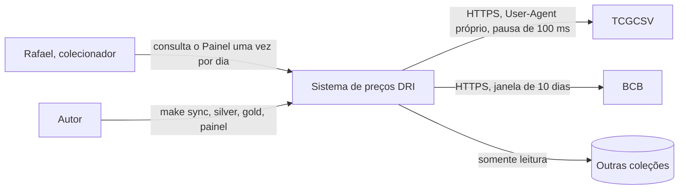
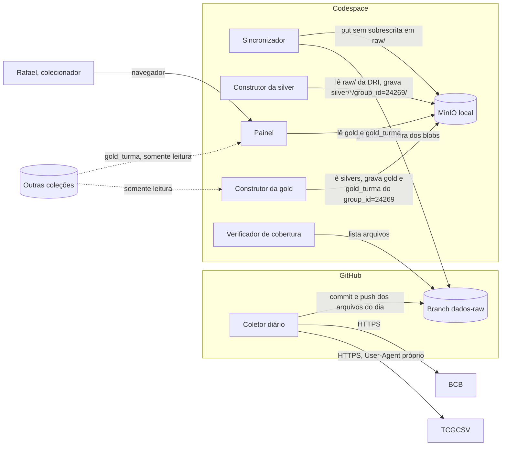
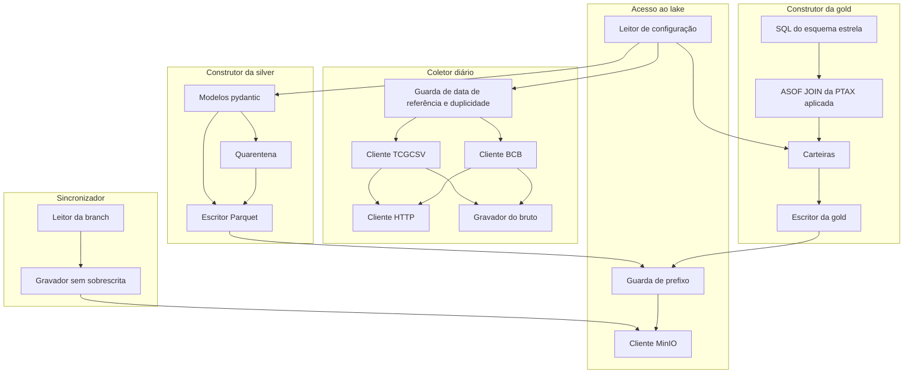

# Plano de arquitetura

Documento derivado de `AGENTS.md`, `docs/00_persona.md`, `docs/01_objetivos_negocio.md` e `specs/spec.md`. Transforma os requisitos em arquitetura e justifica cada escolha por um RF, RNF ou RES. Não contém código; a implementação fica para `specs/tasks.md`.

## 1. Escopo e nomes

O plano confirma a "Arquitetura prevista" do `AGENTS.md`: coleta no GitHub Actions gravando na branch `dados-raw`, sincronização para o MinIO local e silver, gold e painel rodando a partir do MinIO local.

Nomes usados nos diagramas e no texto (sempre estes, sem sinônimos):

| Nome | O que é | Onde roda |
|---|---|---|
| Coletor diário | Job do GitHub Actions que busca TCGCSV, PTAX e CDI e grava as respostas originais | GitHub Actions |
| Branch dados-raw | Branch do repositório que guarda o bruto como arquivos, no caminho idêntico à chave | GitHub |
| Sincronizador | Comando local que copia os arquivos da Branch dados-raw para o MinIO local sem sobrescrever | Codespace |
| MinIO local | Servidor de objetos S3 por docker compose, bucket `tcg` | Codespace |
| Construtor da silver | Comando local que lê o bruto da DRI, valida com pydantic e grava a silver e a quarentena | Codespace |
| Construtor da gold | Comando local que lê as silvers (DRI e outras coleções, somente leitura), monta o esquema estrela e as carteiras | Codespace |
| Painel | Aplicação Streamlit que lê a gold e a gold_turma | Codespace |
| Verificador de cobertura | Comando local que compara o calendário com a Branch dados-raw e a tabela "Dias sem coleta" do README | Codespace |
| TCGCSV | Fonte de produtos e preços (`/tcgplayer/3/24269/products` e `/prices`) | externo |
| BCB | Banco Central do Brasil: PTAX (Olinda) e CDI (SGS) | externo |
| Outras coleções | Silvers e gold_turma de outras coleções no bucket `tcg`, produzidas por terceiros, somente leitura | MinIO local |

## 2. C4 nível 1: contexto



## 3. C4 nível 2: contêineres



O Coletor diário não acessa o MinIO local e não precisa de credenciais do MinIO. As Outras coleções ficam no mesmo bucket `tcg` do MinIO local; aparecem separadas no diagrama porque são de terceiros e só são lidas.

## 4. C4 nível 3: componentes do pipeline



| Componente | Responsabilidade | Requisitos |
|---|---|---|
| Guarda de data de referência e duplicidade | Calcula a data de referência pelo ciclo do TCGCSV (das 20h UTC de D às 20h UTC de D+1 grava `data=D`; spec, Definições; ADR-007), sem recusa por horário. Para cada fonte, verifica se o arquivo da data de referência já existe na Branch dados-raw **antes** de qualquer requisição; se existir, pula a fonte e registra no log. | RF-04, RES-03 |
| Cliente HTTP | Sessão `requests` com o User-Agent de `TCG_USER_AGENT`, pausa mínima de 100 ms entre chamadas, repetição com espera crescente (até 3 repetições após a primeira chamada, com esperas de 2, 4 e 8 s) e contagem de requisições. | RF-03, RNF-12 |
| Cliente TCGCSV | Busca `products` e `prices` do groupId 24269. | RF-01 |
| Cliente BCB | Busca a PTAX (Olinda, `CotacaoMoedaPeriodo` com moeda USD, que traz o tipo de boletim) e o CDI (SGS, série 12) nos 10 dias corridos até a data de referência (ADR-007). Endpoints exatos a confirmar na tarefa. | RF-01, RES-04, RES-05 |
| Gravador do bruto | Grava o corpo HTTP byte a byte em `raw/<fonte>/group_id=24269/data=AAAA-MM-DD/<arquivo>` no checkout da Branch dados-raw, em modo de criação exclusiva (falha se o arquivo existir). | RF-02, RES-08 |
| Leitor da branch | `git fetch` da Branch dados-raw e leitura dos arquivos pelos blobs (`git ls-tree` e `git cat-file`), sem checkout e sem conversão de fim de linha. | RF-05 |
| Gravador sem sobrescrita | Para cada arquivo: `stat_object` na chave; se existir, recusa e registra no log; se não, `put_object` e confere o hash com o do blob. | RF-05, RNF-03 |
| Leitor de configuração | Lê `config/colecao.toml`, `config/parametros.toml` (com `tomllib`) e as variáveis de ambiente do `.env`. | RF-01, RF-03, RF-06, RF-24 |
| Cliente MinIO | SDK `minio`, credenciais só de variáveis de ambiente. | RF-02, RF-05, RNF-08 |
| Guarda de prefixo | Único ponto de escrita e de exclusão do código fora de `raw/`. Aceita só `silver/*/group_id=24269/`, `gold/group_id=24269/` e `gold_turma/carteira/group_id=24269/`; recusa qualquer chave em `raw/` ou de outro group_id. | RNF-03, RES-08, RF-13 |
| Modelos pydantic | Um modelo por tabela da silver; classifica `tipo_produto`; preço ausente vira nulo; descarta boletins da PTAX diferentes de `Fechamento`; detecta valor divergente entre brutos. | RF-06, RF-07, RF-08, RF-09 |
| Quarentena | Grava as linhas inválidas em `silver/quarentena/group_id=24269/` com motivo e `chave_raw`; registra a contagem por tabela no log. | RF-07 |
| Escritor Parquet | Grava as tabelas da silver pelo DuckDB, nos caminhos e tipos do contrato. | RF-06 |
| SQL do esquema estrela | Monta `dim_produto`, `dim_colecao`, `dim_data`, `dim_acabamento`, `fato_preco_diario` e `fato_cambio_diario`, lendo a silver de todas as coleções por curinga. | RF-10, RF-12 |
| ASOF JOIN da PTAX aplicada | Liga cada dia à PTAX de maior `data` ≤ dia; nunca uma posterior. | RF-11, RNF-01 |
| Carteiras | Funções Python puras de composição (só dados do primeiro dia) e de liquidação diária; métricas; os dados entram e saem pelo DuckDB. | RF-23, RF-24, RF-25 |
| Escritor da gold | Grava a gold e a gold_turma da DRI pela Guarda de prefixo. | RF-10, RF-26 |

## 5. Fluxo diário

1. **20h30 UTC** (principal) e **06h30 UTC** (reserva): o agendador do GitHub Actions dispara o Coletor diário. A reserva só requisita os arquivos que faltarem na data de referência. O autor também pode disparar manualmente (`workflow_dispatch`), de preferência a partir das 20h30 UTC (ADR-007).
2. O job (Python 3.13) faz checkout da `main` (código) e da Branch dados-raw num diretório separado. Um grupo de concorrência impede duas execuções simultâneas.
3. A Guarda de data de referência e duplicidade calcula a data de referência: antes de 20h UTC, a data UTC do momento menos um dia; a partir de 20h UTC, a data UTC do momento. Não há recusa por horário.
4. Para cada fonte (TCGCSV, PTAX, CDI), de forma independente:
   - se o arquivo do dia já existe na Branch dados-raw, a fonte é pulada e o log registra o motivo, sem nenhuma requisição;
   - senão, o Cliente TCGCSV ou o Cliente BCB faz a busca pelo Cliente HTTP, com User-Agent, pausa e repetição;
   - se a resposta vier com sucesso, o Gravador do bruto grava o corpo original; se todas as tentativas falharem, nada é gravado para aquela fonte e o erro vai para o log.
   - O TCGCSV grava `products.json` e `prices.json`; a fonte só conta como coletada no dia quando os dois existem. Como cada arquivo é verificado antes da requisição, o TCGCSV continua com no máximo uma coleta por dia.
5. Se houver arquivo novo, o job faz commit com a mensagem `dados(coleta): AAAA-MM-DD [RF-01]` e push **só** na Branch dados-raw. O job tem só a permissão `contents: write` do `GITHUB_TOKEN`; não usa nenhum secret nem credencial do MinIO.
6. Se alguma fonte falhou, o job termina com status de falha, para que o autor veja no histórico do Actions. A reexecução no mesmo ciclo (disparo manual antes das 20h UTC do dia seguinte) busca só as fontes cujo arquivo do dia ainda não existe.
7. **No Codespace**, o autor roda `make up`: o MinIO local sobe e o healthcheck confirma que está pronto.
8. `make sync`: o Sincronizador lê a Branch dados-raw e envia ao bucket `tcg` cada arquivo ainda ausente, com a mesma chave; chaves existentes são recusadas e registradas no log.
9. `make silver`: o Construtor da silver lê todo o bruto da DRI, valida, grava as cinco tabelas e a quarentena e registra a contagem de quarentena por tabela. PTAX e CDI repetidos em janelas de dias diferentes viram uma única linha; valores divergentes vão para a quarentena.
10. `make gold`: o Construtor da gold lê `silver/preco_diario/*/*/*.parquet`, `silver/produto/*/*.parquet` e `silver/colecao/*/*.parquet` de todas as coleções (somente leitura) e câmbio e CDI só da silver da DRI; monta o esquema estrela, faz o ASOF JOIN e calcula as carteiras; grava em `gold/group_id=24269/` e `gold_turma/carteira/group_id=24269/`.
11. `make painel`: o Painel abre, lê a gold da DRI e a `gold_turma/carteira/` de todas as coleções e mostra P1 a P5, carteiras e placar, com a data de corte e o aviso de período curto.
12. Se uma fonte não foi gravada no dia, o autor registra o dia na tabela "Dias sem coleta" do README, com o motivo. PTAX e CDI se recuperam pela janela de 10 dias do dia seguinte; o TCGCSV não se recupera. `make cobertura` confere que nenhuma data ficou sem arquivo nem registro.

## 6. Escolhas técnicas

| Escolha | Alternativas consideradas (motivo do descarte) | Requisito/restrição | ADR |
|---|---|---|---|
| Coletor diário no GitHub Actions, cron `30 20 * * *` (principal) e `30 6 * * *` (reserva) mais `workflow_dispatch`, Python 3.13 | cron dentro do Codespace (hiberna quando parado); agendador no computador do autor (depende da máquina ligada); cron em serviço externo pago (RES-02) | RF-01, RF-04, RNF-13, RES-03, RES-07 | ADR-001, ADR-007 |
| Bruto gravado como arquivo na Branch dados-raw, no caminho idêntico à chave, commit e push só nessa branch | MinIO público pago no Railway (RES-02; exigiria credencial no Actions); artifacts do Actions (expiram, sem chave fixa); bruto na `main` (mistura dados e código) | RF-01, RF-02, RNF-08, RNF-09, RES-06, RES-08 | ADR-001 |
| `.gitattributes` com `* -text` na Branch dados-raw | confiar na configuração padrão do Git (pode converter fim de linha); compactar os arquivos (deixa de ser a resposta original) | RF-02, RES-08 | ADR-001 |
| Fontes verificadas e gravadas de forma independente; checagem de existência antes de qualquer requisição | coleta tudo-ou-nada (perde PTAX e CDI quando só o TCGCSV falha); checar só na hora de gravar (o RF-04 exige que nenhuma requisição seja enviada) | RF-01, RF-04, RES-03, OBJ-01 | ADR-001 |
| Sincronizador: leitura pelos blobs do Git, `stat_object` antes de `put_object`, conferência de hash | `mc mirror` (sobrescrita depende de flag, difícil de testar); rclone (dependência a mais, mesmo risco); checkout da branch em pasta de trabalho (risco de conversão e de arquivo alterado à mão) | RF-05, RNF-03, RES-08 | ADR-001 |
| MinIO local por docker compose, `ghcr.io/coollabsio/minio:RELEASE.2025-10-15T17-29-55Z`, portas 9000 e 9001, volume nomeado, healthcheck `mc ready local`, credenciais do `.env` | tag `latest` (quebra a reprodução); imagem `minio/minio` do Docker Hub (deixou de ser publicada); bind mount na pasta do repositório (risco de ir para o Git); binário instalado à mão (não reproduzível) | RES-07, RNF-07, RNF-09, RNF-10 | ADR-002 |
| `requests` para HTTP | httpx (assincronia desnecessária numa coleta sequencial com pausa); `urllib` (sem sessão, mais código) | RF-01, RF-03, RNF-12 | — |
| SDK `minio` para gravar e ler objetos | boto3 (mais pesado, mesmo papel); `mc` por subprocess (difícil de testar) | RF-02, RF-05 | — |
| Silver em Python com modelos pydantic v2 e quarentena por linha | pandera (valida o DataFrame, motivo por linha é trabalhoso); validação com `if` manuais (sem contrato declarativo) | RF-06, RF-07, RF-08, RF-09 | ADR-004 |
| DuckDB com httpfs para ler e gravar Parquet no MinIO, gold em SQL, ASOF JOIN | pandas com `merge_asof` (funciona, mas gold menos auditável); Spark (fora da escala); banco relacional ou ClickHouse (exigem servidor; fora da spec) | RF-10, RF-11, RF-12, RNF-01, RNF-04 | ADR-003 |
| Gold em esquema estrela, com fatos e dimensões do contrato | tabela única larga (duplica atributos; o contrato pede dimensões); snowflake (complexidade sem ganho) | RF-10, RF-17, RF-18 | ADR-003 |
| Outras coleções lidas por curinga (`preco_diario`, `produto`, `colecao`); câmbio e CDI só da silver da DRI; escrita só no prefixo da DRI | lista fixa de group_ids em config (precisa de manutenção); copiar silvers alheias para o nosso prefixo (viola RES-08); usar o câmbio de cada coleção (pode divergir e não é dado coletado por nós) | RF-10, RF-17, RF-22, RF-28, RES-13 | ADR-003 |
| Carteiras em funções Python puras; dados entram e saem pelo DuckDB | carteiras em SQL (unidades inteiras, caixa e juros compostos ficam difíceis de ler e testar); pandas (dependência a mais sem ganho) | RF-23, RF-24, RF-25, RF-26, RNF-05 | ADR-005, ADR-006 |
| Composição só com dados do primeiro dia; fallback do selado para o de maior preço | recompor a carteira todo dia (o OBJ-05 proíbe); escolher o selado manualmente (não reproduzível) | RF-23, OBJ-05 | ADR-006 |
| Regra da carteira propria definida pelo autor; sem ADR, "regra pendente" | regra decidida pelo agente (a spec atribui ao autor); omitir a carteira (o contrato da gold_turma a inclui) | RF-23, OBJ-05 | ADR-005 |
| `make reprocessar` apaga e reconstrói só silver, gold e gold_turma do `group_id=24269`, pela Guarda de prefixo | sobrescrever sem apagar (deixa objetos órfãos); versionar cada execução no caminho (muda o contrato) | RF-13, RNF-03, RNF-04, RES-08 | ADR-004 |
| Streamlit para o Painel | Dash (mais código de layout); Metabase ou Superset (servidor extra, fora da spec); notebook (não é painel) | RF-14 a RF-22, RF-25, RF-28 | — |
| pytest, vcrpy (respostas HTTP gravadas) e testcontainers (MinIO descartável) | responses ou requests-mock (não gravam respostas reais, que o RNF-06 pede); moto (simula S3, não MinIO); MinIO de trabalho nos testes (viola RNF-07) | RNF-05, RNF-06, RNF-07 | — |
| Bloqueio de rede nos testes de unidade por fixture em `tests/conftest.py` que substitui `socket.socket` | pytest-socket (biblioteca nova sem necessidade); confiar na disciplina (não prova o RNF-05) | RNF-05 | — |
| `config/colecao.toml` e `config/parametros.toml`, lidos com `tomllib` | YAML (dependência a mais); variáveis de ambiente (parâmetros não são segredo e precisam ser versionados); constantes no código | RF-01, RF-03, RF-06, RF-24 | — |
| Makefile como ponto de entrada único | scripts shell soltos (sem ponto de entrada único); CLI com typer (dependência a mais) | RNF-10, RF-13, RF-27, OBJ-06 | — |
| `logging` padrão na saída padrão, sem nenhum valor de credencial | loguru ou structlog (dependência a mais); arquivo de log (risco de vazar e de ir para o Git) | RF-02, RF-03, RF-04, RF-07, RNF-08 | — |
| Verificador de cobertura lê a Branch dados-raw, fonte de verdade do bruto | ler o MinIO local (pode estar desatualizado até o próximo `make sync`); ler o histórico do Actions (não diz quais arquivos existem) | RF-27, OBJ-01 | — |
| Python 3.13, a versão que já vem instalada no Codespace; as bibliotecas escolhidas são compatíveis com ela | 3.12 (não vem no Codespace e exigiria instalar outro interpretador, o que dificulta a reprodução a partir de clone limpo); 3.14 (compatibilidade das bibliotecas menos garantida); 3.10 (sem `tomllib`) | RNF-10 (decisão do autor) | — |
| Branch dados-raw criada uma única vez pelo autor, numa tarefa de implementação, como branch órfã contendo só o `.gitattributes` e um README curto; o agente prepara os comandos e o autor executa | criação automática pelo Coletor diário na primeira execução (mistura preparação e coleta, e o job ganharia permissão de criar branches sem revisão); branch derivada da `main` (carrega código e histórico para a branch de dados) | RF-02, RES-08, AGENTS.md (o agente não faz commit nem push) | ADR-001 |
| Mensagem do commit automático do Coletor diário: `dados(coleta): AAAA-MM-DD [RF-01]` | `chore(coleta): bruto de AAAA-MM-DD` (o tipo `chore` não distingue dados de manutenção); mensagem livre (não rastreável até o requisito) | RF-01, DRV-06 | ADR-001 |
| `TCG_USER_AGENT` como variável do repositório (`vars`), não secret; o workflow não usa nenhum secret e tem só a permissão `contents: write` para o push na Branch dados-raw | `TCG_USER_AGENT` como secret (não é sensível e ficaria mascarado nos logs sem motivo); token pessoal com permissões amplas (credencial a mais para proteger) | RNF-08, RNF-13, RES-06 | ADR-001 |

## 7. Reprocessamento e exclusões

- `make reprocessar` apaga e reconstrói **somente**:
  - `tcg/silver/*/group_id=24269/` (inclui `silver/quarentena/group_id=24269/`);
  - `tcg/gold/group_id=24269/`;
  - `tcg/gold_turma/carteira/group_id=24269/`.
- Nunca apaga nada em `tcg/raw/` nem em prefixo de outro group_id.
- Toda exclusão do código passa por uma única função da Guarda de prefixo, que valida cada chave contra a lista acima antes de chamar o SDK e recusa qualquer chave em `raw/` ou de outro group_id. Um teste confirma a recusa (RNF-03).
- Depois de apagar, roda `make silver` e `make gold` a partir do bruto. Duas execuções seguidas produzem o mesmo conteúdo (RF-13, RNF-04).
- `make silver` e `make gold` sozinhos também reconstroem tudo a partir do bruto, sobrescrevendo as chaves determinísticas dos prefixos acima, sem apagar.
- O `make reprocessar` é executado pelo autor. O agente continua proibido de executar qualquer exclusão (ver seção 15).

## 8. Configuração

`config/colecao.toml` (RF-06): `nome = "SV10: Destined Rivals"`, `sigla = "DRI"`, `data_lancamento = 2025-05-30`, `responsavel = "Augusto"`, `group_id = 24269`.

`config/parametros.toml` (valores iniciais da spec, hipótese: validação pendente):

| Parâmetro | Valor inicial | Requisito |
|---|---|---|
| `janela_dias` (PTAX e CDI) | 10 | RF-01 |
| `tentativas` | 3 | RF-03 |
| `esperas_s` | [2, 4, 8] | RF-03 |
| `pausa_minima_ms` | 100 | RF-03, RES-03 |
| `hora_virada_ciclo_utc` | 20 | RF-01, RF-04, RES-03 |
| `limite_requisicoes_dia` | 10000 | RNF-12 |
| `taxa_venda` | 0.15 | RF-24 |
| `preco_minimo_p1_usd` / `preco_minimo_p5_usd` | 1 / 5 | RF-14, RF-15, RF-19 |

Variáveis de ambiente (nomes do `.env.example`, valores só no `.env`): `MINIO_ENDPOINT`, `MINIO_ACCESS_KEY`, `MINIO_SECRET_KEY`, `MINIO_BUCKET`, `MINIO_SECURE`, `GROUP_ID`, `TCG_USER_AGENT`. O docker compose repassa `MINIO_ACCESS_KEY` e `MINIO_SECRET_KEY` ao servidor como usuário e senha raiz. No GitHub Actions, `TCG_USER_AGENT` vem de uma variável do repositório (`vars`), não de um secret, porque não é sensível; o workflow não usa nenhum secret e o push usa o `GITHUB_TOKEN` do próprio job, com só a permissão `contents: write`.

## 9. Estrutura de pastas

```text
.github/workflows/coleta.yml      # Coletor diário (cron 20h30 e 06h30 UTC + workflow_dispatch)
config/
  colecao.toml
  parametros.toml
docker-compose.yml                # MinIO local
Makefile
pyproject.toml                    # dependências com versões fixadas
src/tcg/
  config.py                       # Leitor de configuração
  log.py                          # configuração do logging
  coleta/
    __main__.py                   # ponto de entrada do Coletor diário
    guarda.py                     # Guarda de data de referência e duplicidade
    http.py                       # Cliente HTTP
    tcgcsv.py                     # Cliente TCGCSV
    bcb.py                        # Cliente BCB
    gravador.py                   # Gravador do bruto
  sync/
    leitor_branch.py              # Leitor da branch
    sincronizador.py              # Gravador sem sobrescrita
  lake/
    cliente.py                    # Cliente MinIO
    guarda_prefixo.py             # Guarda de prefixo (única escrita e exclusão fora de raw/)
    duckdb.py                     # conexão DuckDB com httpfs apontada para o MinIO local
  silver/
    modelos.py                    # Modelos pydantic
    quarentena.py                 # Quarentena
    construtor.py                 # Construtor da silver e Escritor Parquet
  gold/
    sql/                          # SQL do esquema estrela e ASOF JOIN
    carteiras.py                  # Carteiras (funções puras)
    construtor.py                 # Construtor da gold e Escritor da gold
  cobertura/
    verificador.py                # Verificador de cobertura
  reprocessar.py
dashboard/
  app.py                          # Painel (Streamlit)
tests/
  conftest.py                     # fixture que bloqueia socket nos testes de unidade
  unidade/
  integracao/
    cassetes/                     # respostas HTTP gravadas (vcrpy)
```

Na Branch dados-raw ficam só `.gitattributes`, um README curto e `raw/tcgplayer/...`, `raw/bcb_ptax/...` e `raw/bcb_cdi/...`, nos caminhos do contrato. A branch é criada uma única vez pelo autor, como branch órfã, numa tarefa de implementação; o agente prepara os comandos e o autor executa.

## 10. Comandos de execução

| Comando | O que faz | Requisito |
|---|---|---|
| `make up` | Sobe o MinIO local por docker compose e espera o healthcheck | RES-07 |
| `make sync` | Roda o Sincronizador (Branch dados-raw → bucket `tcg`, sem sobrescrita) | RF-05 |
| `make silver` | Roda o Construtor da silver | RF-06 a RF-09 |
| `make gold` | Roda o Construtor da gold, incluindo carteiras e gold_turma | RF-10 a RF-12, RF-23 a RF-26 |
| `make reprocessar` | Apaga só silver, gold e gold_turma do `group_id=24269` e roda `silver` e `gold` | RF-13 |
| `make painel` | Abre o Painel (Streamlit) | RF-14 a RF-22, RF-25, RF-28 |
| `make test` | Roda pytest (unidade sem rede, integração com cassetes e MinIO descartável) | RNF-05 a RNF-07 |
| `make cobertura` | Roda o Verificador de cobertura sobre a Branch dados-raw e o README | RF-27 |

O Coletor diário não tem alvo no Makefile: o workflow chama `python -m tcg.coleta` com o diretório da Branch dados-raw como destino.

Sequência a partir de um clone limpo (RNF-10): copiar `.env.example` para `.env` e preencher, instalar as dependências, `make up`, `make sync`, `make silver`, `make gold`, `make test`, `make painel`.

## 11. Logs

- Módulo `logging` padrão, saída padrão, formato com data e hora UTC, nível e componente.
- Registram: cada requisição (fonte, status, tentativa, espera), data de referência calculada, recusas por arquivo existente, recusas de sobrescrita no Sincronizador, contagem de quarentena por tabela, contagem de linhas gravadas por tabela e chaves apagadas pelo reprocessamento.
- Nunca registram valor de credencial, cabeçalho de autenticação nem URL com credencial. Um teste confere que nenhum valor das variáveis `MINIO_ACCESS_KEY` e `MINIO_SECRET_KEY` aparece na saída (RNF-08).

## 12. ADRs previstos

Serão escritos na etapa de validação; aqui só número e título.

| ADR | Título |
|---|---|
| ADR-001 | Bruto versionado na Branch dados-raw com sincronização para o MinIO local |
| ADR-002 | Imagem do MinIO com tag fixada |
| ADR-003 | Esquema estrela na gold e leitura de outras coleções |
| ADR-004 | Camadas derivadas e reprocessamento |
| ADR-005 | Regra da carteira propria |
| ADR-006 | Fallback do selado |
| ADR-007 | Data de referência pelo ciclo do TCGCSV e agendamento redundante |

## 13. Riscos técnicos iniciais

| # | Risco | Efeito | Mitigação |
|---|---|---|---|
| R-01 | O agendador do GitHub Actions atrasa ou descarta execuções em horário de carga. | Dia sem coleta se o atraso passar das 20h UTC do dia seguinte (fim do ciclo). | Data de referência pelo ciclo do TCGCSV e cron de reserva às 06h30 UTC (ADR-007); disparo manual dentro do ciclo; documentar no README. |
| R-02 | Workflows agendados rodam só a partir da branch padrão e são desativados após 60 dias sem atividade no repositório. | Coleta para sem aviso. | Arquivo do workflow fica na `main`; o prazo (12/12/2026) é menor que 60 dias de inatividade; conferir o histórico de execuções. |
| R-03 | Conversão de fim de linha ou de codificação altera o bruto. | Hash do bruto diferente da resposta original (RF-02). | `.gitattributes` com `* -text` na Branch dados-raw; Sincronizador lê os blobs com `git cat-file`; teste de hash. |
| R-04 | Duas execuções simultâneas fazem push na Branch dados-raw. | Conflito de push ou arquivo duplicado. | Grupo de concorrência no workflow; criação exclusiva de arquivo. |
| R-05 | Formato real do TCGCSV diferente das hipóteses (selados sem preço, raridades fora da lista, número ausente, imagem ou link nulos). | P2, carteira selado, `tipo_produto` e RF-20 afetados. | Validação na primeira coleta; ajustes registrados na spec e no ADR-006. |
| R-06 | API do BCB instável ou com formato diferente (boletins, feriados, CDI publicado no dia seguinte). | PTAX ou CDI faltando no dia. | Janela de 10 dias; repetição com espera; divergência entre brutos vai para a quarentena. |
| R-07 | Imagem `ghcr.io/coollabsio/minio` é mantida pela comunidade; `mc ready local` pode não existir nela. | `make up` sem healthcheck válido. | Tag fixada; confirmar o healthcheck na tarefa de implementação do docker compose. |
| R-08 | Extensão httpfs do DuckDB é baixada na primeira carga; configuração S3 do MinIO (estilo de caminho, sem SSL) costuma falhar. | Gold não lê nem grava no MinIO. | Instalar a extensão na preparação do ambiente; configuração centralizada em `src/tcg/lake/duckdb.py`; teste de integração com testcontainers. |
| R-09 | Silvers de outras coleções fora do contrato (colunas ou tipos diferentes) ou curinga sem nenhum arquivo de terceiros. | Erro na gold ou dado misturado. | Leitura com união por nome de coluna; coleção incompatível é ignorada com aviso no log; cenário sem outras coleções coberto por teste (RF-22). |
| R-10 | Exclusão errada no reprocessamento. | Perda de dados derivados de terceiros ou do bruto. | Guarda de prefixo como única função de exclusão; teste de recusa para `raw/` e outros group_ids (RNF-03); o bruto também está na Branch dados-raw. |
| R-11 | Volume do MinIO local perdido (Codespace apagado). | MinIO vazio. | Bruto reconstruído pela Branch dados-raw com `make sync`; silver e gold por `make reprocessar`. |
| R-12 | Gravação de Parquet a partir dos modelos pydantic pelo DuckDB sem pandas nem pyarrow. | Conversão de tipos errada (DATE, TIMESTAMP). | Tabela temporária com tipos do contrato; teste de contrato de colunas e tipos (RF-06). |

## 14. Perguntas abertas

| # | Pergunta | Encaminhamento |
|---|---|---|
| 1 | Regra da carteira propria. | ADR-005, antes do primeiro cálculo (RF-23). |
| 2 | Endpoints exatos do BCB (Olinda `CotacaoMoedaPeriodo` e SGS série 12) e formato das respostas. | Confirmar na tarefa do Cliente BCB. |
| 3 | Hipóteses da spec: `tipo_produto`, raridades "Double Rare em diante", identificação do booster box, imagem e link, preço dos selados, janela e repetição. | Validar na primeira coleta. |
| 4 | Healthcheck `mc ready local` na imagem fixada. | Confirmar na tarefa do docker compose. |

## 15. Ajustes necessários em outros artefatos

| Artefato | Ajuste | Situação |
|---|---|---|
| `specs/spec.md`, RNF-03 | Trocar "o código não tem chamadas de exclusão" pela exclusão restrita à Guarda de prefixo, com teste de recusa. | Aplicado nesta etapa. |
| `AGENTS.md`, comandos proibidos | `make reprocessar`, executado pelo autor, é a única exceção à proibição de exclusões; o agente continua proibido de executar qualquer exclusão. | Aplicado nesta etapa. |
| `README.md` | Documentar o disparo manual dentro do ciclo (antes das 20h UTC do dia seguinte) e o cron de reserva como mitigação do atraso do cron (R-01, ADR-007) e os passos de "Como rodar". | Tarefa futura. |
| `AGENTS.md`, "Arquitetura prevista" | Trocar "a confirmar no plan.md" por referência a este plano. | Tarefa futura, se o autor quiser. |
| `docs/prompts.md` | Registrar o prompt desta etapa e o resultado da revisão. | Pelo autor. |
